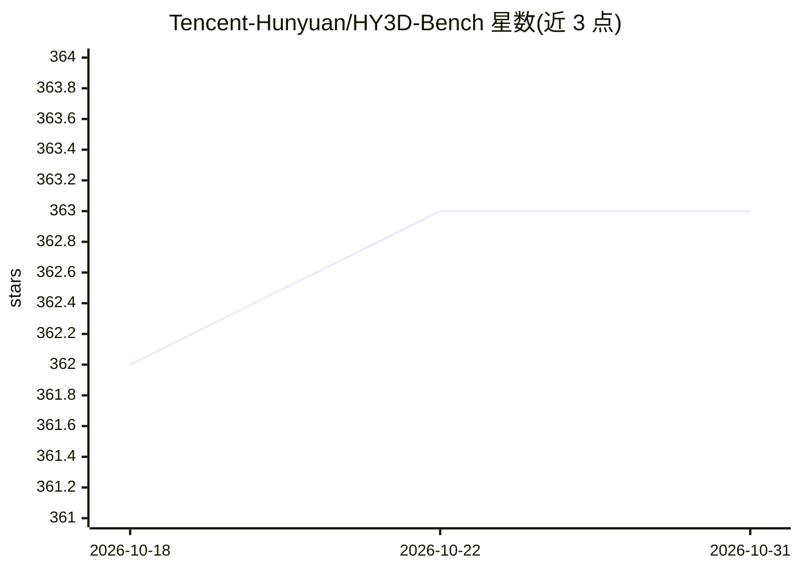

# Tencent-Hunyuan/HY3D-Bench

⭐ 363 · Python · NOASSERTION · 推送 2026-02-27 · [GitHub](https://github.com/Tencent-Hunyuan/HY3D-Bench) · 组织维护 · 中文 README

**腾讯发布的高质量 3D 数据集合集，供 3D 生成模型训练评测**

HY3D-Bench 是腾讯混元发布的三个互补 3D 数据集合集：Full-level（25.2 万+水密网格，含多视角渲染与采样点，约 11TB）、Part-level（24 万+带部件级分解的物体，约 5TB）、Synthetic（12.5 万+由 LLM→扩散→图生 3D 流程合成的长尾物体，覆盖 1,252 细分类别，约 6.5TB）。所有网格经水密、归一化与清洗处理，格式统一。另提供基于 Full-level 数据训练的基线模型 Hunyuan3D-Shape-v2-1 Small（0.8B DiT，2048/4096 tokens 两版）。数据集经 Hugging Face Datasets 分发。

## 筛选速览

| 维度 | 判定 | 备注 |
|---|---|---|
| AI 角色 | `ai-knowledge` | 知识聚合/清单类 |
| 许可风险 | `none` | NOASSERTION |
| 部署形态 | `None` |  |
| 模型依赖 | — | README 未给出锁定关系 |
| 硬件要求 | — | 无带数字的原话,不猜 |
| 安装摩擦 | `low` | 无编译、无系统依赖或容器化 |
| 成熟度 | — | 结构信号不足 |

## 能力要点

- 三个子集合计 60 万+ 3D 物体，全部水密、归一化、清洗
- 部件级数据集提供部件分割标签与独立部件网格
- 合成子集由 LLM→Diffusion→Image-to-3D 流程生成长尾类别
- 附带 0.8B 基线模型（Hunyuan3D-Shape-v2-1 Small）用于验证数据效果

## 适用场景

- 训练 3D 生成模型（diffusion/GAN/自回归）
- 单视图转 3D 与 3D 重建基准评测
- 机器人抓取规划与 affordance 学习的部件级数据
- 长尾类别数据增强与零样本泛化评测

## 场景标签

`模型评测` `模型训练` · 领域:评测与运维

## 证据(README 行号)

> L2: - **Feb 04, 2026**: 🎉 We release **HY3D-Bench** - a comprehensive collection of high-quality 3D datasets with 3 DIFF
> L15: **HY3D-Bench** is a collection of high-quality 3D datasets designed to address the critical limitations of existing
> L17: We release **three complementary datasets** that provide clean, structured, and diverse 3D content for research in 

## 星数曲线

2026-10-18 362 → 2026-10-31 363（+1）

---
*卡片 v1 · prompt 1.4 · 生成 2026-10-21 · 置信度 high · 依据 README sha `81396e5308ee` · [字段定义](../../DATASET.md)*
