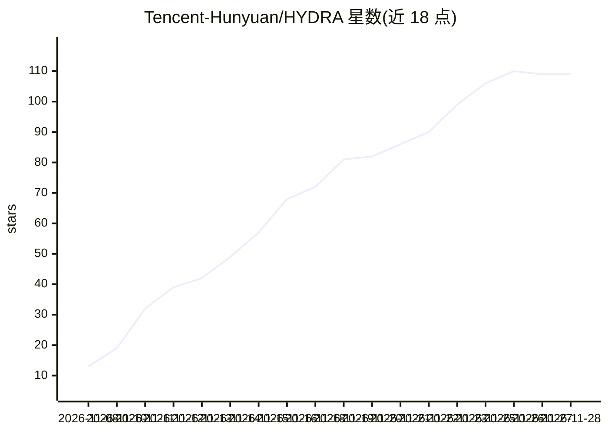

# Tencent-Hunyuan/HYDRA

⭐ 109 · Python · MIT · 推送 2026-10-14 · [GitHub](https://github.com/Tencent-Hunyuan/HYDRA) · [官网](https://bollossom.github.io/HYDRA/) · 组织维护 · 中文 README

**统一多模态理解与文生图生成的模型及 tokenizer（NeurIPS 2026）**

HYDRA 提出一个纯 ViT、无量化的 tokenizer（HYDRA-TOK），通过 Gen-ViT 到 Sem-ViT 的过渡与 Generation-Semantic Bottleneck 兼顾生成与理解；统一模型采用双头解码（文本自回归 + 图像修正流匹配），基于 Qwen2.5-1.5B/7B 骨干，以单个共享参数空间同时支持多模态理解（MMU）与文生图（T2I）。权重托管于 HuggingFace，推理、三阶段训练与评测代码均已开源，MIT 许可。限制：transformers 须为 4.x（≥4.45,<5）；训练配置中数据路径为占位符，需自行填充。

## 筛选速览

| 维度 | 判定 | 备注 |
|---|---|---|
| AI 角色 | `ai-native` | 本体是模型或模型工具 |
| 许可风险 | `permissive` | MIT |
| 部署形态 | `library` | 以包/库形式分发 |
| 模型依赖 | — | README 未给出锁定关系 |
| 硬件要求 | — | 无带数字的原话,不猜 |
| 安装摩擦 | `low` | 无编译、无系统依赖或容器化 |
| 成熟度 | — | 结构信号不足 |

## 能力要点

- 纯 ViT、无量化的 HYDRA-TOK tokenizer（GAN 微调与 base 两个变体）
- 双头解码（AR 文本 + 修正流匹配图像）共享单一参数空间
- HYDRA-1.5B 与 HYDRA-7B 权重托管 HuggingFace，hf:// 路径首次运行自动下载
- 提供三阶段渐进训练流程与 tokenizer 蒸馏/评测脚本

## 适用场景

- 在单模型内同时做多模态理解问答与文生图
- 复现论文的 GenEval/WISE/DPG-Bench 评测结果
- 基于 HYDRA-TOK 做图像重建或作为训练初始化

## 场景标签

`多模态` `图像生成` · 领域:内容生成

## 证据(README 行号)

> L26: - 🧩 **HYDRA-TOK — one pure-ViT tokenizer, no quantization.** The backbone
> L31: - 🔗 **HYDRA — a native unified framework.** A dual-head decoder (autoregressive
> L51: - **HYDRA-1.5B** and **HYDRA-7B** — the unified models (MMU + T2I), built on

## 星数曲线

2026-11-08 13 → 2026-11-28 109（+96）

---
*卡片 v1 · prompt 1.4 · 生成 2026-11-18 · 置信度 high · 依据 README sha `bedcaee931db` · [字段定义](../../DATASET.md)*
