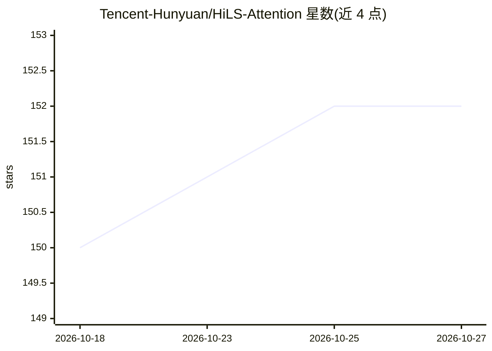

# Tencent-Hunyuan/HiLS-Attention

⭐ 152 · Python · 推送 2026-08-13 · [GitHub](https://github.com/Tencent-Hunyuan/HiLS-Attention) · 组织维护 · 中文 README

**论文官方代码：可端到端学习的层级稀疏注意力机制**

Tencent Hunyuan 团队发布的论文《Hierarchical Sparse Attention Done Right: Toward Infinite Context Modeling》官方实现。HiLS-Attention 是一种 chunk 级稀疏注意力机制：用压缩 chunk key 估计 chunk-mass 代理值做 top-k 块选择，将注意力分解为块间与块内 softmax，在语言建模损失下端到端学习块选择，实现原生稀疏训练。提供从头训练/继续预训练脚本、预训练权重（含 7B 模型）、PPL/RULER/LongBench/OpenCompass 评测脚本，以及 SGLang 服务后端（alexzms/SGLang-HiLS，OpenAI 兼容 API）。限制：SGLang 后端有约束（page-size 须等于 chunk_size 64、单序列 prefill、禁用 overlap scheduler）。

## 筛选速览

| 维度 | 判定 | 备注 |
|---|---|---|
| AI 角色 | `ai-native` | 本体是模型或模型工具 |
| 许可风险 | `none` | — |
| 部署形态 | `library` | 以包/库形式分发 |
| 模型依赖 | — | README 未给出锁定关系 |
| 硬件要求 | — | 无带数字的原话,不猜 |
| 安装摩擦 | `low` | 无编译、无系统依赖或容器化 |
| 成熟度 | — | 结构信号不足 |

## 能力要点

- 用压缩 chunk key 估计 chunk-mass 代理值，端到端学习稀疏块选择
- 提供从头训练、继续预训练与 landmark-token 微调脚本
- 发布预训练 checkpoint（含 OLMo3-7B 继续训练版本）
- 原生 SGLang 服务后端，OpenAI 兼容 API，长上下文推理加速随序列长度增加

## 适用场景

- 复现论文中的长上下文稀疏注意力训练与评测
- 在 OLMo3 等基座上继续预训练获得长上下文模型
- 用 SGLang 部署 HiLS-Attention checkpoint 做长上下文推理服务

## 场景标签

`模型训练` `微调` · 领域:训练与推理

## 证据(README 行号)

> L9: HiLS-Attention is a chunk-wise sparse attention mechanism that learns chunk selection end-to-end under the language-
> L3: Official code for the paper Hierarchical Sparse Attention Done Right: Toward Infinite Context Modeling.

## 星数曲线

2026-10-18 150 → 2026-10-27 152（+2）

---
*卡片 v1 · prompt 1.4 · 生成 2026-10-22 · 置信度 mid · 依据 README sha `c4e138a04361` · [字段定义](../../DATASET.md)*
