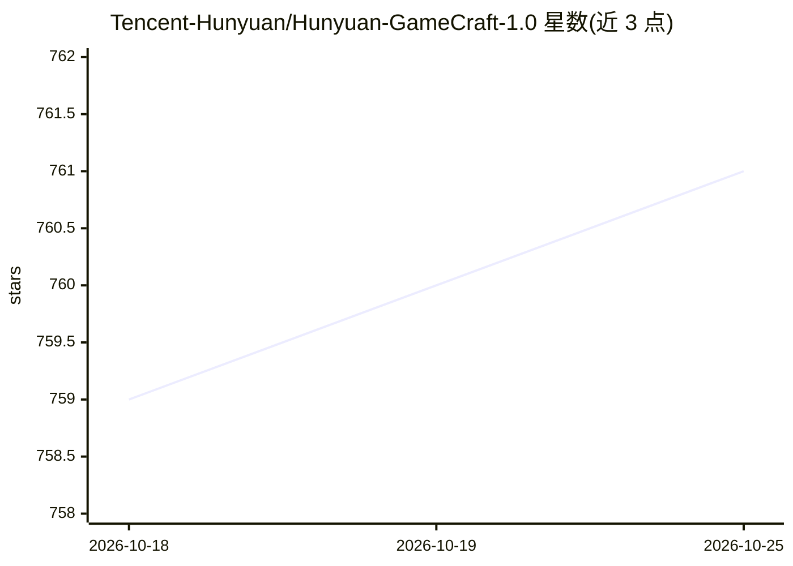

# Tencent-Hunyuan/Hunyuan-GameCraft-1.0

⭐ 762 · Python · NOASSERTION · 推送 2025-11-28 · [GitHub](https://github.com/Tencent-Hunyuan/Hunyuan-GameCraft-1.0) · [官网](https://hunyuan-gamecraft.github.io/) · 组织维护 · 中文 README

**腾讯混元游戏视频生成模型：键盘鼠标交互式生成游戏画面**

腾讯混元开源的交互式游戏视频生成框架：将键盘鼠标输入统一映射到共享相机表示空间，通过混合历史条件策略自回归延长视频序列，并经模型蒸馏降低推理开销。训练数据为百万余条覆盖 100+ 3A 游戏的录像。发布推理代码、模型权重与 Gradio demo，支持多 GPU 并行、FP8 与 SageAttention 加速及低显存单卡路径；需 NVIDIA GPU（最低 24GB，推荐 80GB），测试环境为 Linux 与 8*H20/H800。

## 筛选速览

| 维度 | 判定 | 备注 |
|---|---|---|
| AI 角色 | `ai-native` | 本体是模型或模型工具 |
| 许可风险 | `none` | NOASSERTION |
| 部署形态 | `self-host` | docker 或自建部署 |
| 模型依赖 | — | README 未给出锁定关系 |
| 硬件要求 | `gpu-24g` | |
| 安装摩擦 | `low` | 无编译、无系统依赖或容器化 |
| 成熟度 | — | 结构信号不足 |

## 能力要点

- 键盘鼠标输入统一到共享相机空间实现细粒度动作控制
- 混合历史条件自回归长视频扩展
- 模型蒸馏与 FP8/SageAttention 加速
- 提供多 GPU 并行、低显存单卡与 Gradio Web 界面

## 适用场景

- 按动作序列生成游戏玩法长视频
- 研究交互式可控视频生成方法
- 在单张 24GB 显存显卡上运行低显存推理

## 场景标签

`视频生成` · 领域:内容生成

## 证据(README 行号)

> L28: Recent advances in diffusion-based and controllable video generation have enabled high-quality and temporally coher
> L38: * An NVIDIA GPU with CUDA support is required.

## 星数曲线

2026-10-18 759 → 2026-10-25 761（+2）

---
*卡片 v1 · prompt 1.4 · 生成 2026-10-21 · 置信度 mid · 依据 README sha `758e97ad074f` · [字段定义](../../DATASET.md)*
