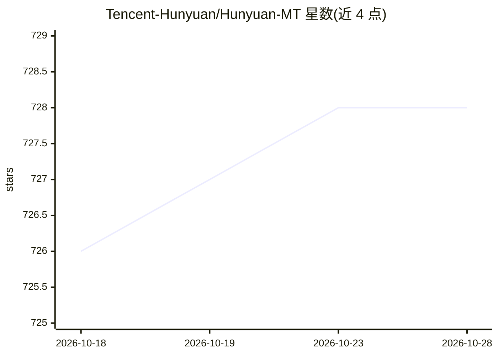

# Tencent-Hunyuan/Hunyuan-MT

⭐ 727 · Python · NOASSERTION · 推送 2025-12-30 · [GitHub](https://github.com/Tencent-Hunyuan/Hunyuan-MT) · 组织维护 · 中文 README

**腾讯混元开源翻译模型：7B 翻译模型与集成模型，33 语言互译**

腾讯混元开源的机器翻译模型系列，包含 Hunyuan-MT-7B 翻译模型与 Hunyuan-MT-Chimera 集成模型，后者将多个翻译输出融合为单一结果；支持 33 种语言互译，含中国五种少数民族语言。模型权重发布于 Hugging Face 与 ModelScope，提供 fp8 量化版本。README 给出 transformers 推理、vLLM/TensorRT-LLM/SGLang 部署命令与 LLaMA-Factory 训练流程，附技术报告（arXiv:2509.05209）。

## 筛选速览

| 维度 | 判定 | 备注 |
|---|---|---|
| AI 角色 | `ai-native` | 本体是模型或模型工具 |
| 许可风险 | `none` | NOASSERTION |
| 部署形态 | `self-host` | docker 或自建部署 |
| 模型依赖 | local-ok | 支持本地模型 |
| 硬件要求 | — | 无带数字的原话,不猜 |
| 安装摩擦 | `low` | 无编译、无系统依赖或容器化 |
| 成熟度 | — | 结构信号不足 |

## 能力要点

- Hunyuan-MT-7B 翻译模型 + Hunyuan-MT-Chimera 多译文集成模型
- 33 种语言互译，含中国五种少数民族语言
- 提供 fp8/Int4 量化版本与 vLLM/TensorRT-LLM/SGLang 部署命令
- 附 LLaMA-Factory 训练流程（CPT→SFT→翻译 RL→集成 RL）

## 适用场景

- 我需要一个可本地部署的多语种翻译模型
- 在 WMT25 类翻译任务中集成多个译文产出更优结果
- 用自己的平行语料对翻译模型做继续微调

## 场景标签

`微调` · 领域:训练与推理

## 证据(README 行号)

> L14: The Hunyuan-MT comprises a translation model, Hunyuan-MT-7B, and an ensemble model, Hunyuan-MT-Chimera. The transla
> L18: - In the WMT25 competition, the model achieved first place in 30 out of the 31 language categories it participated 

## 星数曲线

2026-10-18 726 → 2026-10-28 728（+2）

---
*卡片 v1 · prompt 1.4 · 生成 2026-10-21 · 置信度 high · 依据 README sha `0e6051864249` · [字段定义](../../DATASET.md)*
