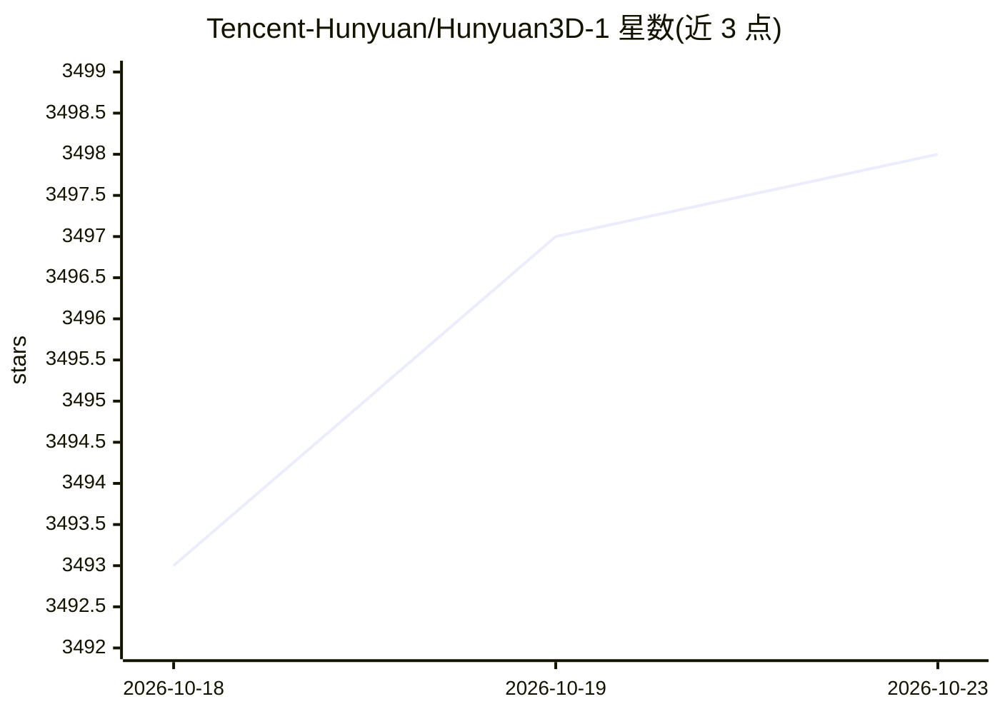

# Tencent-Hunyuan/Hunyuan3D-1

⭐ 3,498 · Python · NOASSERTION · 推送 2025-11-19 · [GitHub](https://github.com/Tencent-Hunyuan/Hunyuan3D-1) · [官网](https://3d.hunyuan.tencent.com/) · 组织维护 · 中文 README

**腾讯开源的文本/图像生成 3D 资产两阶段生成框架**

Hunyuan3D-1.0 提供文本到 3D 与图像到 3D 的生成能力，含 lite 与 standard 两个版本，均支持中英双语文本条件。采用两阶段机制：多视图扩散模型先生成多视角 RGB 图，再用前馈重建模型从多视图图像重建 3D 网格；框架内集成 Hunyuan-DiT 文生图模型。以源码形式发布（git clone + conda 环境 + env_install.sh），模型权重托管于 Hugging Face，另有 Gradio 网页 demo 与纹理烘焙模块（烘焙模块依赖的 Dust3R 为 CC BY-NC-SA 4.0 非商业许可）。标准流水线推理需约 30GB 显存（--save_memory 下 24GB），lite 版需 22GB（18GB）。

## 筛选速览

| 维度 | 判定 | 备注 |
|---|---|---|
| AI 角色 | `ai-native` | 本体是模型或模型工具 |
| 许可风险 | `none` | NOASSERTION |
| 部署形态 | `library` | 以包/库形式分发 |
| 模型依赖 | — | README 未给出锁定关系 |
| 硬件要求 | `gpu-24g` | |
| 安装摩擦 | `high` | 编译与系统依赖俱全 |
| 成熟度 | — | 结构信号不足 |

## 能力要点

- 两阶段生成：多视图扩散（约 4 秒）+ 前馈重建（约 7 秒）
- 同时支持文本与图像条件、中英双语的 3D 生成
- lite 与 standard 双版本，lite 约 10 秒、standard 约 25 秒产出网格
- 提供纹理烘焙模块与 Gradio 网页 demo

## 适用场景

- 输入一句文本描述生成带纹理的 3D 网格模型
- 从单张图片重建 3D 资产用于美术创作流程
- 通过 Gradio 网页在服务器上体验文本/图像到 3D

## 场景标签

 · 领域:3D 生成/生成式 AI

## 证据(README 行号)

> L37: While 3D generative models have greatly improved artists' workflows, the existing diffusion models for 3D generatio
> L126: For text to 3d generation, we supports bilingual Chinese and English, you can use the following command to inferen

## 星数曲线

2026-10-18 3,493 → 2026-10-23 3,498（+5）

---
*卡片 v1 · prompt 1.4 · 生成 2026-10-20 · 置信度 mid · 依据 README sha `264ac6efeb6b` · [字段定义](../../DATASET.md)*
