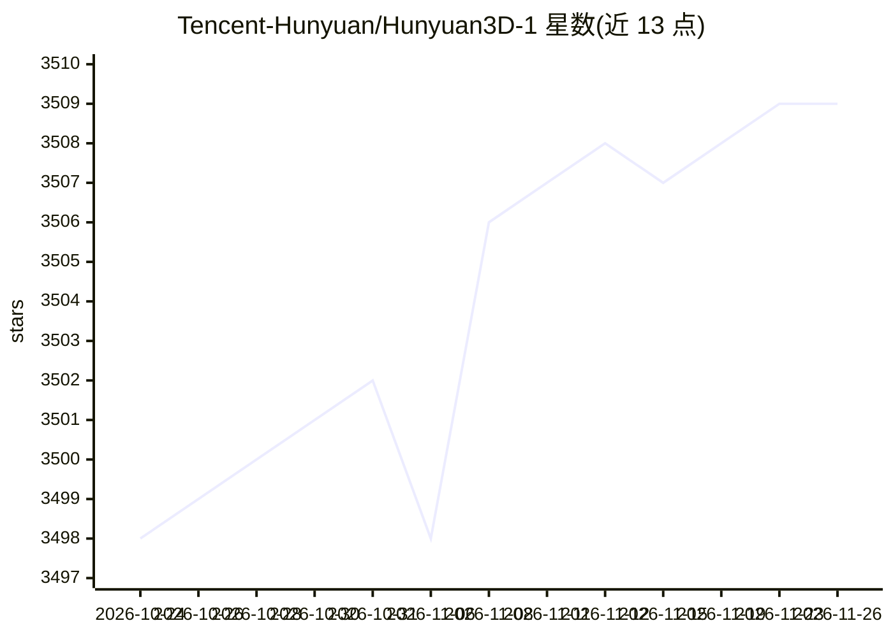

# Tencent-Hunyuan/Hunyuan3D-1

⭐ 3,509 · Python · NOASSERTION · 推送 2026-11-02 · [GitHub](https://github.com/Tencent-Hunyuan/Hunyuan3D-1) · [官网](https://3d.hunyuan.tencent.com/) · 组织维护 · 中文 README

**文本/图像生成 3D 资产的模型框架，含 lite 与 std 两版**

腾讯混元开源的 3D 生成框架，采用两阶段流程：多视角扩散模型约 4 秒生成多视角 RGB，前馈重建模型约 7 秒重建 3D 资产，统一支持文本到 3D 与图像到 3D；文本路径经由 Hunyuan-DiT 文生图模型。提供 lite 与 standard 两个版本（std 参数量为 lite 的 3 倍），推理代码与预训练权重已开源，训练与蒸馏版本在计划中未发布。Baking 纹理烘焙模块依赖 Dust3R，受 CC BY-NC-SA 4.0 非商业许可限制。

## 筛选速览

| 维度 | 判定 | 备注 |
|---|---|---|
| AI 角色 | `ai-native` | 本体是模型或模型工具 |
| 许可风险 | `none` | NOASSERTION |
| 部署形态 | `library` | 以包/库形式分发 |
| 模型依赖 | — | README 未给出锁定关系 |
| 硬件要求 | `gpu-24g` | |
| 安装摩擦 | `high` | 编译与系统依赖俱全 |
| 成熟度 | — | 结构信号不足 |

## 能力要点

- 两阶段生成：多视角扩散（约4秒）+ 前馈重建（约7秒）
- 统一支持文本到 3D 与图像到 3D，文本输入中英双语
- lite 版单图生成 3D mesh 约 10 秒，std 版约 25 秒
- 提供纹理烘焙模块与 Gradio 本地 Web 界面

## 适用场景

- 从一张图片快速生成带纹理的 3D mesh
- 用中文或英文描述直接生成 3D 资产
- 本地部署 Gradio demo 在浏览器中体验 3D 生成
- 游戏/美术流程中的 3D 白模与贴图初稿制作

## 场景标签

`图像生成` · 领域:内容生成

## 证据(README 行号)

> L37: While 3D generative models have greatly improved artists' workflows, the existing diffusion models for 3D generatio
> L124: For text to 3d generation, we supports bilingual Chinese and English, you can use the following command to inferen
> L159: - Inference Std-pipeline requires 30GB VRAM (24G VRAM with --save_memory).

## 星数曲线

2026-10-24 3,498 → 2026-11-26 3,509（+11）

---
*卡片 v1 · prompt 1.4 · 生成 2026-11-23 · 置信度 high · 依据 README sha `c3bde2572559` · [字段定义](../../DATASET.md)*
