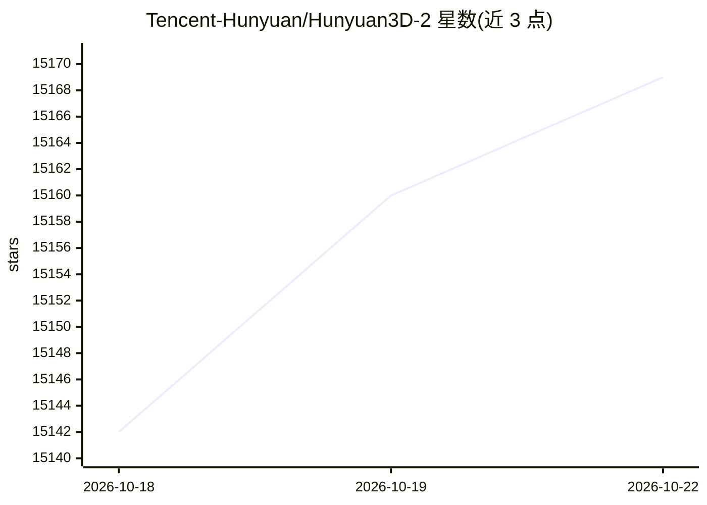

# Tencent-Hunyuan/Hunyuan3D-2

⭐ 15,182 · Python · NOASSERTION · 推送 2025-10-28 · [GitHub](https://github.com/Tencent-Hunyuan/Hunyuan3D-2) · [官网](https://3d.hunyuan.tencent.com/) · 组织维护 · 中文 README

**给创作者/开发者的图像与文本生成高分辨率带纹理 3D 资产的扩散模型系统**

腾讯混元发布的 Hunyuan3D 2.0 开源 3D 生成系统，采用两阶段管线：基于流扩散 transformer 的形状生成模型 Hunyuan3D-DiT 依据条件图像生成网格，纹理合成模型 Hunyuan3D-Paint 为生成或手工网格生成纹理贴图。提供多系列模型（1.1B 标准、0.6B mini、多视图 mv、蒸馏加速 Turbo/Fast 版本），支持 macOS/Windows/Linux，输出 glb/obj 格式。提供 Python API、Gradio App、本地 API Server 与 Blender 插件；形状生成需 6 GB 显存，形状+纹理共需 16 GB。

## 筛选速览

| 维度 | 判定 | 备注 |
|---|---|---|
| AI 角色 | `ai-native` | 本体是模型或模型工具 |
| 许可风险 | `none` | NOASSERTION |
| 部署形态 | `library` | 以包/库形式分发 |
| 模型依赖 | — | README 未给出锁定关系 |
| 硬件要求 | `gpu-8g` | |
| 安装摩擦 | `low` | 无编译、无系统依赖或容器化 |
| 成熟度 | — | 结构信号不足 |

## 动量与使用信号

- 维护:`declining` — 距上次 push 354.9 天,年发版 0,31 位贡献者
- 涨星:近 1 天 **+9**(自 20261016 起算)
- 平台:WINDOWS · 协议:—

## 能力要点

- 两阶段管线：形状生成（Hunyuan3D-DiT）+ 纹理合成（Hunyuan3D-Paint）
- 提供 mini/mv/turbo 等多系列模型，0.6B 起可选
- 提供 Python API、Gradio App、API Server 与 Blender 插件四种使用方式
- 形状生成 6 GB 显存即可运行

## 适用场景

- 从单张或多视图图片生成带纹理的 3D 网格资产
- 为手工建模的网格生成纹理贴图
- 通过 Blender 插件在建模工作流中直接调用 3D 生成
- 部署本地 API 服务供其他应用调用图像转 3D

## 场景标签

 · 领域:AIGC/3D 资产生成

## 证据(README 行号)

> L42: We present Hunyuan3D 2.0, an advanced large-scale 3D synthesis system for generating high-resolution textured 3D as
> L60: Hunyuan3D 2.0 features a two-stage generation pipeline, starting with the creation of a bare mesh, followed by the
> L120: Hunyuan3D 2.0 supports Macos, Windows, Linux. You may follow the next steps to use Hunyuan3D 2.0 via:

## 星数曲线

2026-10-18 15,142 → 2026-10-22 15,169（+27）

---
*卡片 v1 · prompt 1.4 · 生成 2026-10-18 · 置信度 high · 依据 README sha `44ebe8bd2d4a` · [字段定义](../../DATASET.md)*
