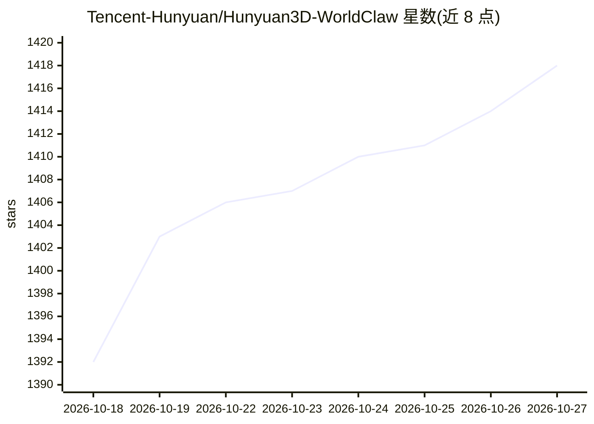

# Tencent-Hunyuan/Hunyuan3D-WorldClaw

⭐ 1,418 · 推送 2026-08-13 · [GitHub](https://github.com/Tencent-Hunyuan/Hunyuan3D-WorldClaw) · [官网](https://tencent-hunyuan.github.io/Hunyuan3D-WorldClaw/) · 组织维护 · 中文 README

**腾讯混元的大规模 3D 开放世界智能体生成研究（论文发布）**

WorldClaw 是腾讯混元团队的研究项目，主题为 Agentic 3D 开放世界生成（at scale）。当前仓库仅发布 arXiv 论文链接、项目主页、Hugging Face 论文页与引用信息，尚未提供代码、模型权重或安装运行说明。给关注 3D 生成与开放世界构建研究的人员查阅论文与跟进后续发布使用。

## 筛选速览

| 维度 | 判定 | 备注 |
|---|---|---|
| AI 角色 | `ai-native` | 本体是模型或模型工具 |
| 许可风险 | `none` | — |
| 部署形态 | `None` |  |
| 模型依赖 | — | README 未给出锁定关系 |
| 硬件要求 | — | 无带数字的原话,不猜 |
| 安装摩擦 | `low` | 无编译、无系统依赖或容器化 |
| 成熟度 | — | 结构信号不足 |

## 能力要点

- 研究主题为 Agentic 3D 开放世界大规模生成
- 提供 arXiv 论文与项目主页链接
- 由腾讯混元团队维护并给出 BibTeX 引用条目

## 适用场景

- 查阅 3D 开放世界智能体生成的论文方法
- 跟进该项目的后续代码与发布动态

## 场景标签

 · 领域:3D 生成/研究

## 证据(README 行号)

> L1: # WorldClaw: Agentic 3D Open-world Generation at Scale
> L22:   title={WorldClaw: Agentic 3D Open-World Generation at Scale},

## 星数曲线

2026-10-18 1,392 → 2026-10-27 1,418（+26）

---
*卡片 v1 · prompt 1.4 · 生成 2026-10-21 · 置信度 low · 依据 README sha `e01303fbba8b` · [字段定义](../../DATASET.md)*
