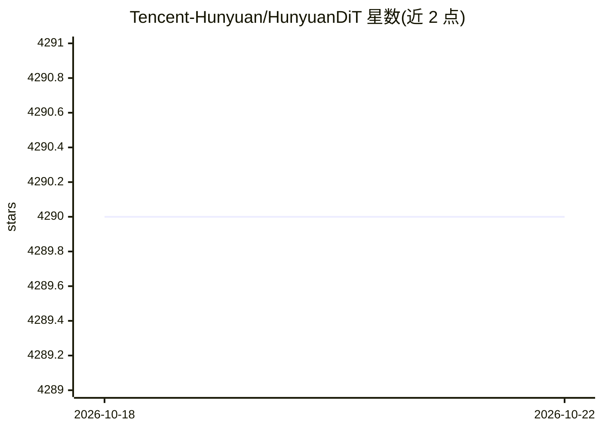

# Tencent-Hunyuan/HunyuanDiT

⭐ 4,289 · Jupyter Notebook · NOASSERTION · 推送 2026-10-08 · [GitHub](https://github.com/Tencent-Hunyuan/HunyuanDiT) · [官网](https://dit.hunyuan.tencent.com/) · 组织维护 · 中文 README

**腾讯开源的中英双语文生图扩散 Transformer 模型及训练推理代码**

Hunyuan-DiT 仓库提供 PyTorch 模型定义、预训练权重与推理/采样代码，配套 DialogGen 提示增强模型与 Hunyuan-Captioner 数据标注模型。架构上采用潜在空间扩散 Transformer，文本编码使用双语 CLIP 与多语言 T5 组合，支持中英双语细粒度理解与多轮对话式文生图。提供 LoRA/ControlNet（canny/pose/depth）/IP-Adapter 训练、蒸馏与 TensorRT 加速版本、6GB 显存推理脚本，并接入 Diffusers、ComfyUI、Kohya 生态。运行需 NVIDIA GPU（最低 11GB 显存，推荐 32GB），测试系统为 Linux。

## 筛选速览

| 维度 | 判定 | 备注 |
|---|---|---|
| AI 角色 | `ai-native` | 本体是模型或模型工具 |
| 许可风险 | `none` | NOASSERTION |
| 部署形态 | `desktop` | 安装包/桌面程序 |
| 模型依赖 | — | README 未给出锁定关系 |
| 硬件要求 | `gpu-8g` | |
| 安装摩擦 | `medium` | 含编译或系统依赖之一 |
| 成熟度 | — | 结构信号不足 |

## 能力要点

- 中英双语 CLIP + 多语言 T5 文本编码的 DiT 架构
- 多轮对话式文生图（MLLM 理解对话并生成新提示词）
- 支持 LoRA / ControlNet / IP-Adapter 训练与 6GB 显存推理
- 提供 Diffusers / ComfyUI / Kohya 接入及蒸馏、TensorRT 加速版本

## 适用场景

- 用中英文提示词在本地生成图像
- 基于预训练权重微调（全参/LoRA）自己的文生图模型
- 通过 ControlNet 按 canny/pose/depth 条件控制生成
- 在 ComfyUI 或 Diffusers 工作流中使用该模型

## 场景标签

`图像生成` `微调` · 领域:内容生成

## 证据(README 行号)

> L11: This repo contains PyTorch model definitions, pre-trained weights and inference/sampling code for our paper explori
> L115: We present Hunyuan-DiT, a text-to-image diffusion transformer with fine-grained understanding of both English and 

## 星数曲线

2026-10-18 4,290 → 2026-10-22 4,290（+0）

---
*卡片 v1 · prompt 1.4 · 生成 2026-10-20 · 置信度 mid · 依据 README sha `b2f99b5dc881` · [字段定义](../../DATASET.md)*
