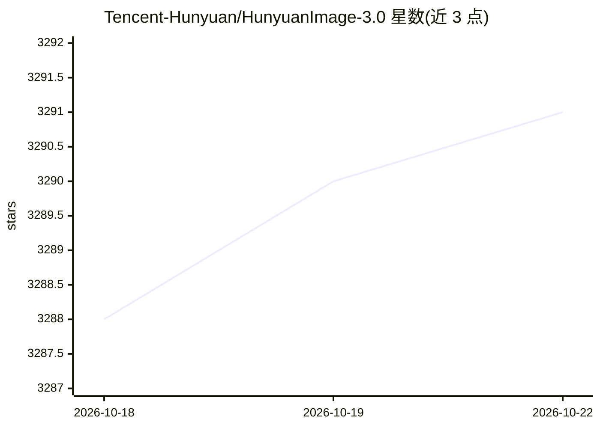

# Tencent-Hunyuan/HunyuanImage-3.0

⭐ 3,292 · Python · NOASSERTION · 推送 2026-06-23 · [GitHub](https://github.com/Tencent-Hunyuan/HunyuanImage-3.0) · [官网](https://hunyuan.tencent.com/image) · 组织维护 · 中文 README

**80B 参数 MoE 文生图/图生图开源模型，供开发者本地部署**

腾讯混元开源的原生多模态自回归图像生成模型，总参数 80B（每 token 激活 13B），提供文生图、图生图编辑、提示词自改写与 CoT 推理（Instruct 版），并有 8 步采样的蒸馏版本。通过 Transformers 或源码仓库运行，支持 vLLM 加速与 FlashInfer/FlashAttention 优化，提供 Gradio 交互界面。显存要求：基础版 ≥3×80GB，Instruct 版 ≥8×80GB，建议多 GPU。技术报告已发布，多轮交互功能尚未开源。

## 筛选速览

| 维度 | 判定 | 备注 |
|---|---|---|
| AI 角色 | `ai-native` | 本体是模型或模型工具 |
| 许可风险 | `none` | NOASSERTION |
| 部署形态 | `library` | 以包/库形式分发 |
| 模型依赖 | local-ok | 支持本地模型 |
| 硬件要求 | — | 无带数字的原话,不猜 |
| 安装摩擦 | `high` | 编译与系统依赖俱全 |
| 成熟度 | — | 结构信号不足 |

## 能力要点

- 80B 参数 MoE 架构（64 专家，13B 激活）
- 文生图、图生图编辑、提示词自改写与 CoT Think
- vLLM 推理加速支持与 FlashInfer/FlashAttention 性能优化
- Instruct-Distil 蒸馏版支持 8 步快速采样

## 适用场景

- 本地部署文生图与图像编辑生成
- 结合输入图片做多图融合与创意编辑
- 需要推理增强提示词理解的图像生成场景

## 场景标签

`图像生成` · 领域:内容生成

## 证据(README 行号)

> L40: **HunyuanImage-3.0** is a groundbreaking native multimodal model that unifies multimodal understanding and generati
> L269: | HunyuanImage-3.0 | 80B total (13B active) | HuggingFace | ≥ 3 × 80 GB | ✅ Text-to-Image

## 星数曲线

2026-10-18 3,288 → 2026-10-22 3,291（+3）

---
*卡片 v1 · prompt 1.4 · 生成 2026-10-20 · 置信度 high · 依据 README sha `2ee3bf384f6c` · [字段定义](../../DATASET.md)*
