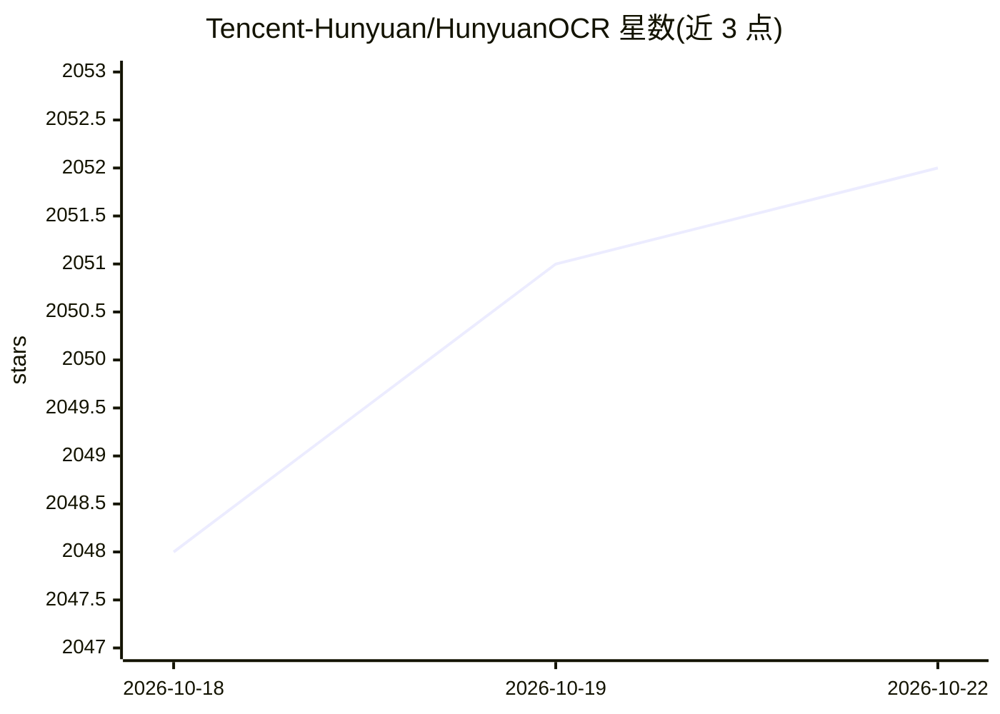

# Tencent-Hunyuan/HunyuanOCR

⭐ 2,053 · Python · NOASSERTION · 推送 2026-09-24 · [GitHub](https://github.com/Tencent-Hunyuan/HunyuanOCR) · 组织维护 · 中文 README

**轻量端到端 OCR 视觉语言模型，覆盖文档解析/文本检测/抽取/图文翻译**

腾讯混元开源的 OCR 专用视觉语言模型 HunyuanOCR-1.5，在单一端到端 VLM 内统一文档解析、文本检测定位、信息抽取与图文翻译，最大图像分辨率 4K、上下文 128K。推理侧提供 vLLM、DFlash 投机解码、原生 transformers 三种配置与 llama.cpp 的 GGUF 部署路径（支持 CPU/消费级 GPU/笔记本）；训练侧开源 SFT 与 DFlash draft 模型训练管线，含序列打包数据处理流程。统一推理环境要求 CUDA 13，llama.cpp 路径 DFlash 已合入上游。

## 筛选速览

| 维度 | 判定 | 备注 |
|---|---|---|
| AI 角色 | `ai-native` | 本体是模型或模型工具 |
| 许可风险 | `none` | NOASSERTION |
| 部署形态 | `library` | 以包/库形式分发 |
| 模型依赖 | local-ok | 支持本地模型 |
| 硬件要求 | — | 无带数字的原话,不猜 |
| 安装摩擦 | `high` | 编译与系统依赖俱全 |
| 成熟度 | — | 结构信号不足 |

## 能力要点

- 单一 VLM 统一文档解析、文本检测、信息抽取、图文翻译四类任务（12 种任务类型）
- DFlash 投机解码加速长结构化输出解码，保持目标模型输出分布
- llama.cpp GGUF 部署支持 CPU/消费级 GPU/笔记本环境
- 开源 SFT 与 DFlash 训练管线及序列打包数据处理脚本

## 适用场景

- 我对文档/表格/公式图片做端到端解析与结构化输出
- 我在笔记本或消费级 GPU 上本地部署 OCR 模型
- 我在自有 OCR 数据上微调或继续训练模型

## 场景标签

`OCR` `文档解析` · 领域:知识与检索

## 证据(README 行号)

> L33: **HunyuanOCR-1.5** is a lightweight, end-to-end OCR-specialized vision-language model. It targets a broad range of 
> L63: open-sources the SFT / DFlash training pipeline and the transformers / vLLM inference stack, so

## 星数曲线

2026-10-18 2,048 → 2026-10-22 2,052（+4）

---
*卡片 v1 · prompt 1.4 · 生成 2026-10-21 · 置信度 high · 依据 README sha `6db3b719e054` · [字段定义](../../DATASET.md)*
