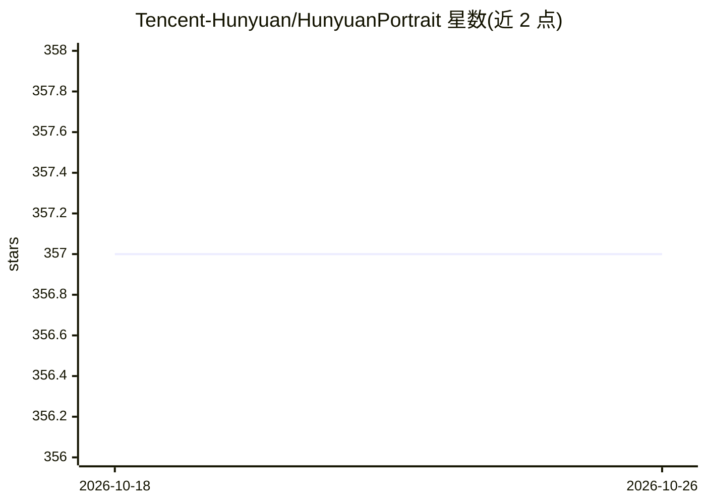

# Tencent-Hunyuan/HunyuanPortrait

⭐ 357 · Python · NOASSERTION · 推送 2025-12-07 · [GitHub](https://github.com/Tencent-Hunyuan/HunyuanPortrait) · 组织维护 · 中文 README

**单张参考图驱动的人物动画生成框架（CVPR 2025）**

腾讯混元开源的扩散模型人物动画框架：从驱动视频中提取表情与姿态的隐式控制信号，经注意力适配器注入稳定的扩散主干（基于 SVD），用单张参考图生成时序一致的人物动画，支持说话、唱歌、做表情等场景。要求 NVIDIA 3090（24G 显存，CUDA）与 Linux 环境，通过 git clone 源码安装，模型权重经 Hugging Face 下载，提供 demo.sh 脚本与 Gradio 网页界面。代码声明仅供学术用途。

## 筛选速览

| 维度 | 判定 | 备注 |
|---|---|---|
| AI 角色 | `ai-native` | 本体是模型或模型工具 |
| 许可风险 | `none` | NOASSERTION |
| 部署形态 | `library` | 以包/库形式分发 |
| 模型依赖 | — | README 未给出锁定关系 |
| 硬件要求 | — | 无带数字的原话,不猜 |
| 安装摩擦 | `medium` | 含编译或系统依赖之一 |
| 成熟度 | — | 结构信号不足 |

## 能力要点

- 驱动视频的隐式条件控制（表情/姿态）注入扩散主干
- 单张参考图生成时序一致的人物动画
- 提供 Gradio Server 网页演示界面

## 适用场景

- 用一张人物照片配合驱动视频生成说话/唱歌动画
- 研究隐式条件控制的人物动画生成方法

## 场景标签

`视频生成` · 领域:内容生成

## 证据(README 行号)

> L59: HunyuanPortrait is a diffusion-based framework for generating lifelike, temporally consistent portrait animations b
> L9: * An NVIDIA 3090 GPU with CUDA support is required.

## 星数曲线

2026-10-18 357 → 2026-10-26 357（+0）

---
*卡片 v1 · prompt 1.4 · 生成 2026-10-21 · 置信度 high · 依据 README sha `71fc476f2868` · [字段定义](../../DATASET.md)*
