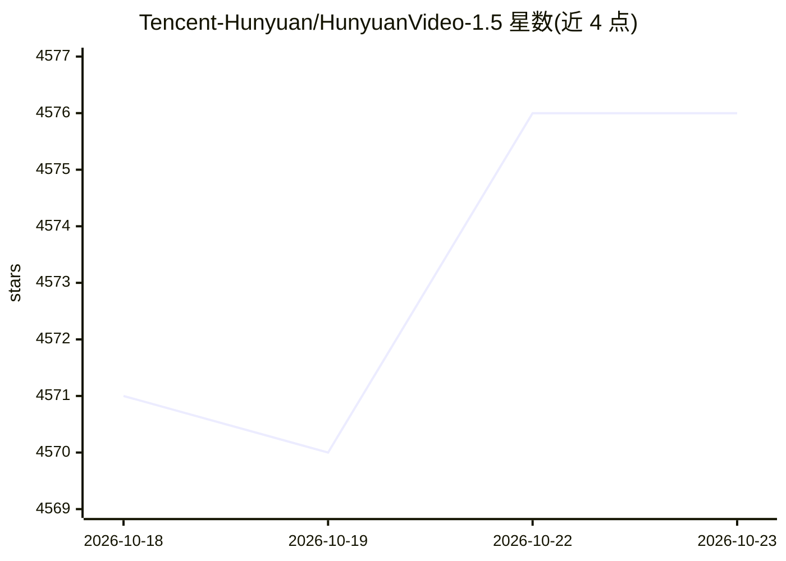

# Tencent-Hunyuan/HunyuanVideo-1.5

⭐ 4,576 · Python · NOASSERTION · 推送 2026-04-10 · [GitHub](https://github.com/Tencent-Hunyuan/HunyuanVideo-1.5) · [官网](https://hunyuan.tencent.com/video/zh?tabIndex=0) · 组织维护 · 中文 README

**腾讯混元开源的 8.3B 参数轻量视频生成模型（文生视频/图生视频）**

腾讯混元开源的视频生成模型及推理/训练代码仓库：8.3B 参数的 DiT 架构配合 3D 因果 VAE 与 SSTA 稀疏注意力，支持文本生成视频与图像生成视频，多时长多分辨率（480P/720P），并带可升级至 1080P 的少步超分网络。提供步数蒸馏模型（RTX 4090 上 75 秒生成 480P 视频）、训练与 LoRA 微调脚本（Muon 优化器）。要求 NVIDIA GPU、最低 14GB 显存（开启模型卸载）、Linux 与 Python 3.10+；提示词改写依赖 vLLM 兼容 API（不配置则跳过）。模型权重托管于 Hugging Face。

## 筛选速览

| 维度 | 判定 | 备注 |
|---|---|---|
| AI 角色 | `ai-native` | 本体是模型或模型工具 |
| 许可风险 | `none` | NOASSERTION |
| 部署形态 | `library` | 以包/库形式分发 |
| 模型依赖 | — | README 未给出锁定关系 |
| 硬件要求 | `gpu-8g` | |
| 安装摩擦 | `medium` | 含编译或系统依赖之一 |
| 成熟度 | — | 结构信号不足 |

## 能力要点

- 8.3B 参数 DiT 架构，支持 T2V 与 I2V，多分辨率多时长
- 步数蒸馏模型：480P I2V 8/12 步生成，单卡 RTX 4090 约 75 秒
- 开源训练代码与 LoRA 微调脚本，使用 Muon 优化器
- 支持 Diffusers、ComfyUI、LightX2V 等社区集成与 cache 推理加速

## 适用场景

- 在消费级 GPU 上本地生成文生视频或图生视频
- 基于开源权重微调（LoRA）定制视频生成效果
- 通过 ComfyUI / Diffusers 工作流集成视频生成能力

## 场景标签

`视频生成` `微调` · 领域:内容生成

## 证据(README 行号)

> L9: HunyuanVideo-1.5 is a video generation model that delivers top-tier quality with only 8.3B parameters, significantly
> L57: We present HunyuanVideo-1.5, a lightweight yet powerful video generation model that achieves state-of-the-art visua

## 星数曲线

2026-10-18 4,571 → 2026-10-23 4,576（+5）

---
*卡片 v1 · prompt 1.4 · 生成 2026-10-20 · 置信度 high · 依据 README sha `a602a39ad377` · [字段定义](../../DATASET.md)*
