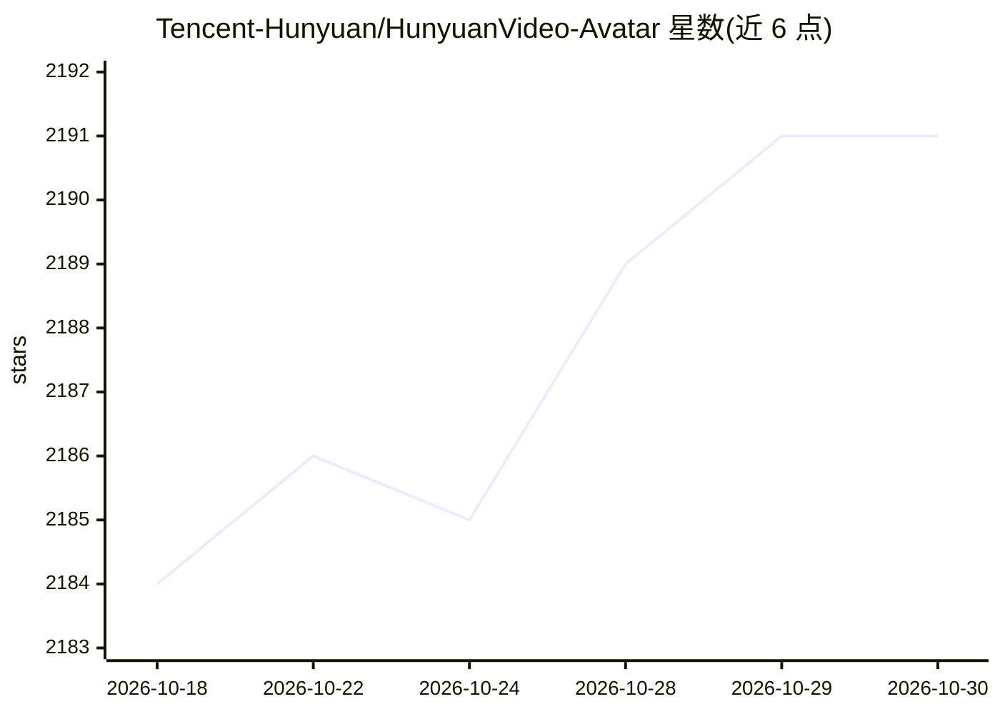

# Tencent-Hunyuan/HunyuanVideo-Avatar

⭐ 2,191 · Python · NOASSERTION · 推送 2025-12-16 · [GitHub](https://github.com/Tencent-Hunyuan/HunyuanVideo-Avatar) · 组织维护 · 中文 README

**音频驱动的人物动画视频生成模型，支持多角色对话**

腾讯混元团队开源的基于多模态扩散 Transformer（MM-DiT）的音频驱动人物动画模型：输入任意风格与分辨率的角色图像和音频，生成动态、情绪可控的单人或多角色对话视频。机制上包含角色图像注入模块、音频情绪模块（AEM）与面部感知音频适配器（FAA）。需要 NVIDIA GPU，最低 24GB 显存（10GB 低显存模式借助 TeaCache），提供推理代码、模型权重、Docker 镜像与 Gradio 服务，测试环境为 Linux、多 GPU 机器。

## 筛选速览

| 维度 | 判定 | 备注 |
|---|---|---|
| AI 角色 | `ai-native` | 本体是模型或模型工具 |
| 许可风险 | `none` | NOASSERTION |
| 部署形态 | `self-host` | docker 或自建部署 |
| 模型依赖 | — | README 未给出锁定关系 |
| 硬件要求 | `gpu-24g` | |
| 安装摩擦 | `low` | 无编译、无系统依赖或容器化 |
| 成熟度 | — | 结构信号不足 |

## 能力要点

- 多风格角色图像（写实/卡通/3D/拟人）驱动生成对话视频
- 情绪参考图迁移控制角色面部情绪（AEM 模块）
- 多角色音频驱动动画（FAA 面部掩码隔离）
- 支持 10GB 显存单卡推理（TeaCache）与多 GPU 并行

## 适用场景

- 用一张角色图和音频生成说话头像视频
- 制作电商、直播、社媒用的数字人内容
- 多角色对话视频创作与内容编辑

## 场景标签

`视频生成` · 领域:内容生成

## 证据(README 行号)

> L36: We propose **HunyuanVideo-Avatar**, a multi-modal diffusion transformer(MM-DiT)-based model capable of generating *
> L42: ### **High-Dynamic and Emotion-Controllable Video Generation**

## 星数曲线

2026-10-18 2,184 → 2026-10-30 2,191（+7）

---
*卡片 v1 · prompt 1.4 · 生成 2026-10-21 · 置信度 mid · 依据 README sha `1f56f19d399f` · [字段定义](../../DATASET.md)*
