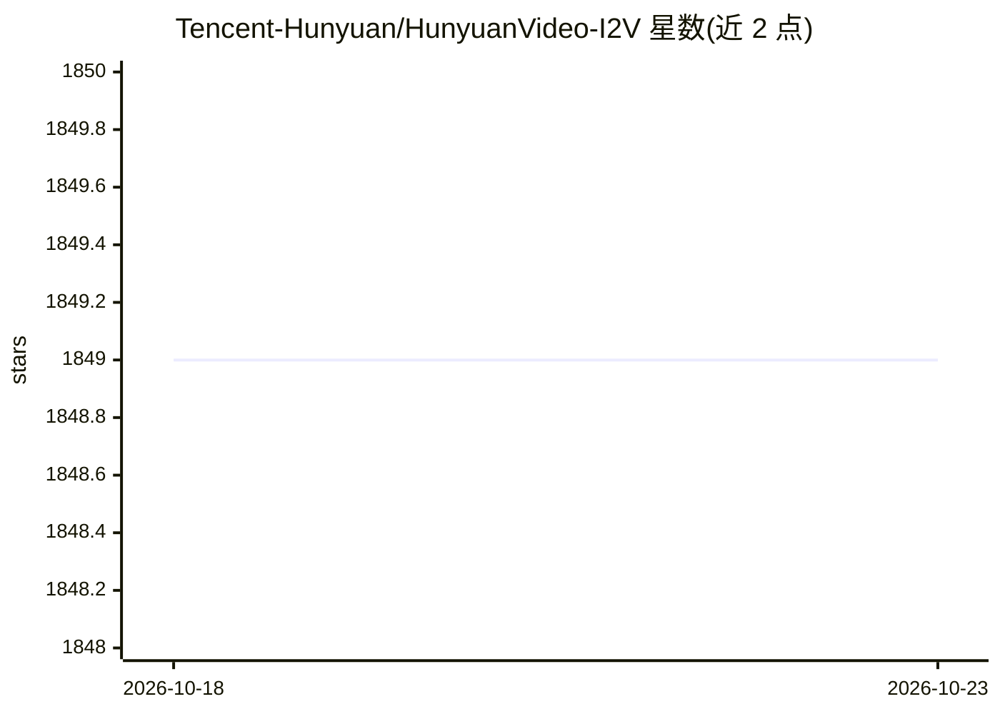

# Tencent-Hunyuan/HunyuanVideo-I2V

⭐ 1,849 · Python · NOASSERTION · 推送 2026-04-07 · [GitHub](https://github.com/Tencent-Hunyuan/HunyuanVideo-I2V) · [官网](https://video.hunyuan.tencent.com/) · 组织维护 · 中文 README

**腾讯混元图生视频模型：基于参考图生成视频并支持 LoRA 定制训练**

HunyuanVideo 的图生视频扩展版本，官方 PyTorch 模型定义、预训练权重与推理代码：输入参考图与文本提示，通过 token replace 技术将 MLLM 生成的图像语义 token 与视频 latent token 拼接做全注意力计算，生成最高 720P、129 帧（5 秒）视频；提供稳定模式与高动态模式两种采样参数。另开源 LoRA 训练代码，可用少量数据定制特效（如头发生长），并支持 xDiT 多 GPU 序列并行推理。硬件要求高：推理需 60GB 显存（推荐 80GB），LoRA 训练需 79GB，仅在 Linux 上测试。

## 筛选速览

| 维度 | 判定 | 备注 |
|---|---|---|
| AI 角色 | `ai-native` | 本体是模型或模型工具 |
| 许可风险 | `none` | NOASSERTION |
| 部署形态 | `self-host` | docker 或自建部署 |
| 模型依赖 | — | README 未给出锁定关系 |
| 硬件要求 | `gpu-24g` | |
| 安装摩擦 | `low` | 无编译、无系统依赖或容器化 |
| 成熟度 | — | 结构信号不足 |

## 能力要点

- 图生视频：最高 720P、129 帧（5 秒）输出，首帧与参考图保持一致
- 采用 MLLM 作为文本编码器，融合图像语义 token 与视频 latent token
- 开源 LoRA 训练脚本，可定制视频特效
- 支持 xDiT 多 GPU 序列并行推理

## 适用场景

- 把静态参考图生成为 5 秒 720P 视频
- 训练 LoRA 制作定制视频特效（如拥抱、头发生长）
- 多 GPU 并行加速视频生成推理

## 场景标签

`视频生成` `微调` · 领域:内容生成

## 证据(README 行号)

> L16: This repo contains official PyTorch model definitions, pre-trained weights and inference/sampling code. You can fin
> L65: Leveraging the advanced video generation capabilities of HunyuanVideo, we have extended its application to image-to
> L67: Since we utilizes a pre-trained Multimodal Large Language Model (MLLM) with a Decoder-Only architecture as the text

## 星数曲线

2026-10-18 1,849 → 2026-10-23 1,849（+0）

---
*卡片 v1 · prompt 1.4 · 生成 2026-10-21 · 置信度 high · 依据 README sha `380d01f7a981` · [字段定义](../../DATASET.md)*
