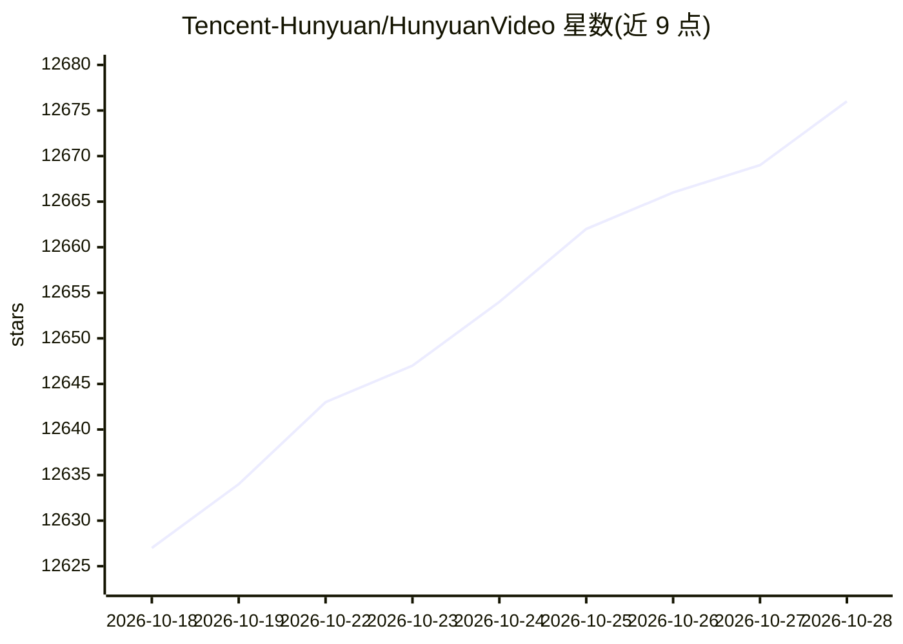

# Tencent-Hunyuan/HunyuanVideo

⭐ 12,683 · Python · NOASSERTION · 推送 2026-10-08 · [GitHub](https://github.com/Tencent-Hunyuan/HunyuanVideo) · [官网](https://aivideo.hunyuan.tencent.com) · 组织维护 · 中文 README

**腾讯开源的 13B 参数文生视频基础模型及推理代码**

提供视频生成基础模型的 PyTorch 模型定义、预训练权重与推理/采样代码，含 13B 参数的 Diffusion Transformer 架构（双流到单流混合设计）、Causal 3D VAE 压缩、MLLM 文本编码器与提示词重写模型（Normal/Master 两种模式）。面向视频生成研究者与开发者，支持多 GPU 序列并行推理、FP8 权重、Gradio Web Demo 与 Diffusers 集成。运行要求 NVIDIA CUDA GPU，720p/129f 生成需约 60GB 显存，推荐 80GB，测试系统为 Linux。衍生模型包括 I2V、Avatar、Custom 与 1.5 版本。

## 筛选速览

| 维度 | 判定 | 备注 |
|---|---|---|
| AI 角色 | `ai-native` | 本体是模型或模型工具 |
| 许可风险 | `none` | NOASSERTION |
| 部署形态 | `self-host` | docker 或自建部署 |
| 模型依赖 | — | README 未给出锁定关系 |
| 硬件要求 | `gpu-24g` | |
| 安装摩擦 | `low` | 无编译、无系统依赖或容器化 |
| 成熟度 | — | 结构信号不足 |

## 能力要点

- 13B 参数开源视频生成模型，提供推理代码与权重
- 双流到单流 Diffusion Transformer 架构与 Causal 3D VAE
- FP8 量化权重与多 GPU 序列并行推理（xDiT）
- 提供 Docker 镜像、Gradio Web Demo 与 Diffusers/ComfyUI 集成

## 适用场景

- 研究者本地运行或复现视频生成模型
- 基于权重微调或开发视频生成应用
- 通过 ComfyUI/Diffusers 生态进行视频生成工作流

## 场景标签

`视频生成` · 领域:内容生成

## 证据(README 行号)

> L17: This repo contains PyTorch model definitions, pre-trained weights and inference/sampling code for our paper explori
> L75: We present HunyuanVideo, a novel open-source video foundation model that exhibits performance in video generation t

## 星数曲线

2026-10-18 12,627 → 2026-10-28 12,676（+49）

---
*卡片 v1 · prompt 1.4 · 生成 2026-10-20 · 置信度 mid · 依据 README sha `542fa9d71f95` · [字段定义](../../DATASET.md)*
