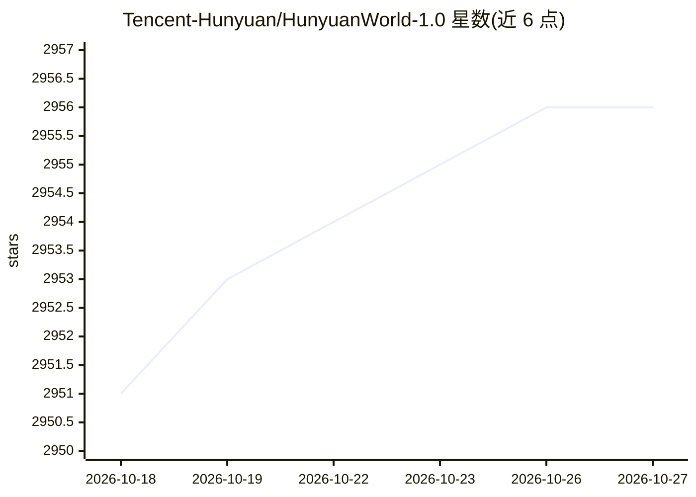

# Tencent-Hunyuan/HunyuanWorld-1.0

⭐ 2,956 · Python · NOASSERTION · 推送 2026-04-15 · [GitHub](https://github.com/Tencent-Hunyuan/HunyuanWorld-1.0) · [官网](https://3d.hunyuan.tencent.com/sceneTo3D) · 组织维护 · 中文 README

**从文本或图像生成可探索交互 3D 世界的开源模型**

腾讯混元团队的 3D 世界生成模型框架：以全景图作为 360° 世界代理，经语义分层与层次化 3D 重建，从文本或图像条件生成可漫游、可交互的 3D 世界，支持网格导出以对接现有图形管线，并提供 Web 浏览器内的 ModelViewer 实时浏览工具。模型基于 Flux，可适配其他图像生成模型。提供推理代码、模型权重、技术报告与量化版（支持 4090 等消费级 GPU），使用 Python 3.10 / PyTorch 2.5.0+cu124 环境，通过 git clone 与 conda 环境配置运行。

## 筛选速览

| 维度 | 判定 | 备注 |
|---|---|---|
| AI 角色 | `ai-native` | 本体是模型或模型工具 |
| 许可风险 | `none` | NOASSERTION |
| 部署形态 | `None` |  |
| 模型依赖 | — | README 未给出锁定关系 |
| 硬件要求 | — | 无带数字的原话,不猜 |
| 安装摩擦 | `medium` | 含编译或系统依赖之一 |
| 成熟度 | — | 结构信号不足 |

## 能力要点

- 文本/图像到全景图再到 3D 世界的两步生成流程
- 语义分层的 3D 网格表示，支持网格导出对接图形管线
- fp8 量化与缓存选项以降低显存占用加速推理
- Web 浏览器 ModelViewer 实时可视化生成的 3D 世界

## 适用场景

- 输入一句话或一张图生成可漫游的 3D 场景
- 为 VR、游戏开发、物理仿真生成 3D 世界素材
- 导出网格接入现有计算机图形流水线

## 场景标签

 · 领域:3D 生成/计算机视觉

## 证据(README 行号)

> L26: Creating immersive and playable 3D worlds from texts or images remains a fundamental challenge in computer vision a
> L101: python3 demo_panogen.py --prompt "" --image_path examples/case2/input.png --output_path test_results/case2
> L109: python3 demo_panogen.py --prompt "At the moment of glacier collapse, giant ice walls collapse and create waves, wi

## 星数曲线

2026-10-18 2,951 → 2026-10-27 2,956（+5）

---
*卡片 v1 · prompt 1.4 · 生成 2026-10-21 · 置信度 high · 依据 README sha `9cb91d0aa74b` · [字段定义](../../DATASET.md)*
