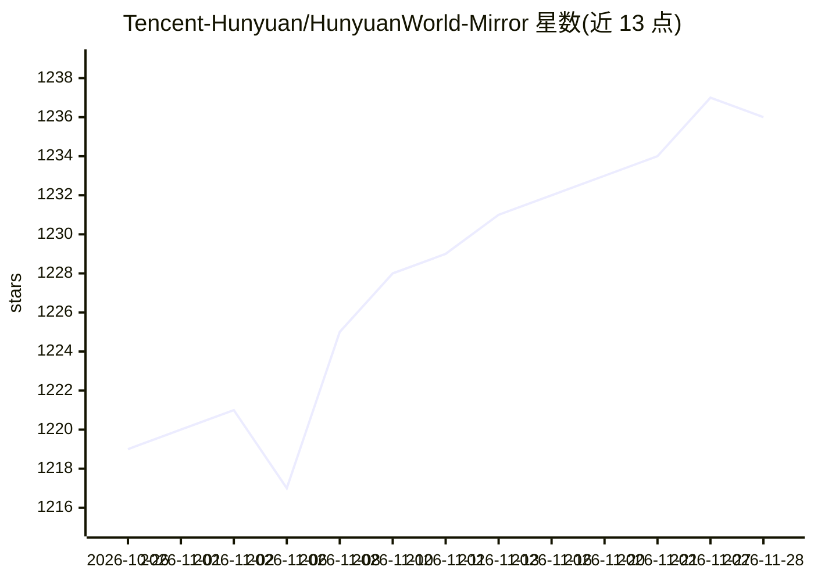

# Tencent-Hunyuan/HunyuanWorld-Mirror

⭐ 1,236 · Python · NOASSERTION · 推送 2026-11-25 · [GitHub](https://github.com/Tencent-Hunyuan/HunyuanWorld-Mirror) · [官网](https://3d-models.hunyuan.tencent.com/world/) · 组织维护 · 中文 README

**前馈式 3D 重建模型：一次前向生成点云/深度/位姿/高斯**

腾讯混元发布的通用前馈 3D 重建模型，单次前向同时生成点云、多视角深度、相机参数、表面法线与 3D Gaussians，并可嵌入内参、位姿、深度等先验作为提示（Multi-Modal Prior Prompting）。提供推理代码与预训练权重、Gradio 本地与在线 Demo、两阶段训练代码及五类任务的评测脚本；输出可导出 COLMAP 格式并用 gsplat 做 3DGS 后优化。面向从事 3D 视觉重建研究的开发者与科研人员，推荐 CUDA 12.4 手动安装，未提供桌面安装包与 Docker 方式。

## 筛选速览

| 维度 | 判定 | 备注 |
|---|---|---|
| AI 角色 | `ai-native` | 本体是模型或模型工具 |
| 许可风险 | `none` | NOASSERTION |
| 部署形态 | `library` | 以包/库形式分发 |
| 模型依赖 | — | README 未给出锁定关系 |
| 硬件要求 | — | 无带数字的原话,不猜 |
| 安装摩擦 | `medium` | 含编译或系统依赖之一 |
| 成熟度 | — | 结构信号不足 |

## 能力要点

- 单次前向同时预测点云、深度、法线、相机参数与 3D Gaussians
- 支持以内参、相机位姿、深度作为可选先验输入
- 提供 Gradio 在线 Demo 与本地 Demo
- 开放训练代码（两阶段）与五类任务评测脚本

## 适用场景

- 从多视角图像重建点云与表面法线
- 从图像做新视角合成渲染
- 导出 3DGS/COLMAP 结果做后续场景优化
- 复现论文中 3D 感知任务的评测与训练

## 场景标签

 · 领域:3D 视觉/AIGC

## 证据(README 行号)

> L6: HunyuanWorld-Mirror is a versatile feed-forward model for comprehensive 3D geometric prediction. It integrates diver
> L33: **(2) Universal Geometric Prediction**: A unified architecture capable of handling
> L131: HunyuanWorld-Mirror achieves state-of-the-art performance across multiple 3D perception tasks, surpassing feed-for

## 星数曲线

2026-10-26 1,219 → 2026-11-28 1,236（+17）

---
*卡片 v1 · prompt 1.4 · 生成 2026-11-26 · 置信度 high · 依据 README sha `90a3b46512db` · [字段定义](../../DATASET.md)*
