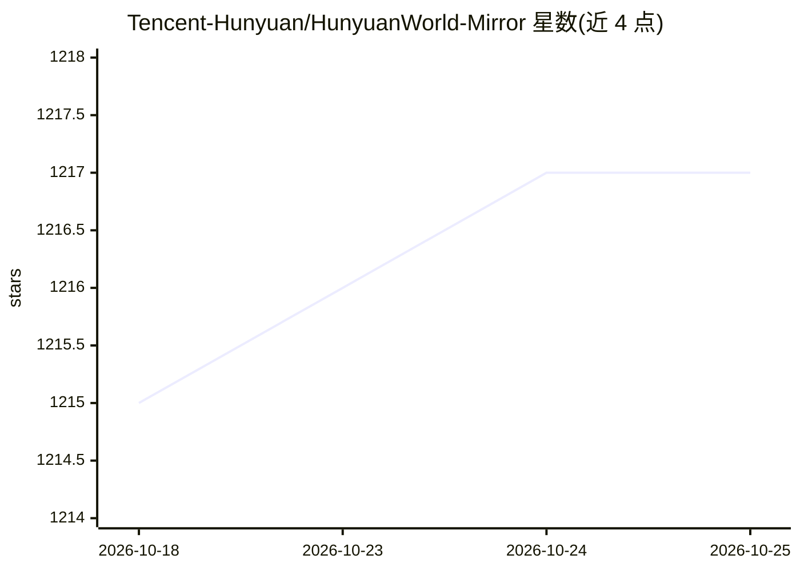

# Tencent-Hunyuan/HunyuanWorld-Mirror

⭐ 1,217 · Python · NOASSERTION · 推送 2026-05-27 · [GitHub](https://github.com/Tencent-Hunyuan/HunyuanWorld-Mirror) · [官网](https://3d-models.hunyuan.tencent.com/world/) · 组织维护 · 中文 README

**腾讯混元的单次前向 3D 几何预测模型：点云/深度/位姿/3DGS**

ICML 2026 论文 WorldMirror 的官方开源实现（腾讯混元团队）。该模型在单次前向传播中同时输出 3D 点云、深度图、相机位姿、内参、表面法线与 3D Gaussian 等多种 3D 表示；支持将任意子集的几何先验（内参/位姿/深度）经轻量编码层注入以提升精度。提供推理代码、模型权重、Gradio 本地/在线 Demo，以及两阶段训练与五类任务评测代码；可选 3DGS 后优化，可导出 COLMAP 格式。需 CUDA 环境（推荐 12.4）。

## 筛选速览

| 维度 | 判定 | 备注 |
|---|---|---|
| AI 角色 | `ai-native` | 本体是模型或模型工具 |
| 许可风险 | `none` | NOASSERTION |
| 部署形态 | `library` | 以包/库形式分发 |
| 模型依赖 | — | README 未给出锁定关系 |
| 硬件要求 | — | 无带数字的原话,不猜 |
| 安装摩擦 | `medium` | 含编译或系统依赖之一 |
| 成熟度 | — | 结构信号不足 |

## 能力要点

- 单次前向同时生成点云/深度/法线/相机参数/多视深度/3D Gaussians
- 任意先验子集（内参/位姿/深度）注入的多模态先验提示机制
- 提供推理、Gradio Demo、两阶段训练与五类任务评测代码
- 支持导出 COLMAP 格式与可选 3DGS 后优化

## 适用场景

- 从多张图像做前馈 3D 重建并渲染新视角
- 利用已有相机位姿或深度先验提升重建精度
- 在自有数据上复现训练与五类 3D 任务评测
- 将重建结果导出为 3D Gaussian Splatting 做后优化

## 场景标签

 · 领域:3D 视觉/生成式 AI

## 证据(README 行号)

> L6: HunyuanWorld-Mirror is a versatile feed-forward model for comprehensive 3D geometric prediction. It integrates diver
> L33: **(2) Universal Geometric Prediction**: A unified architecture capable of handling

## 星数曲线

2026-10-18 1,215 → 2026-10-25 1,217（+2）

---
*卡片 v1 · prompt 1.4 · 生成 2026-10-21 · 置信度 high · 依据 README sha `607c5fbc5b77` · [字段定义](../../DATASET.md)*
