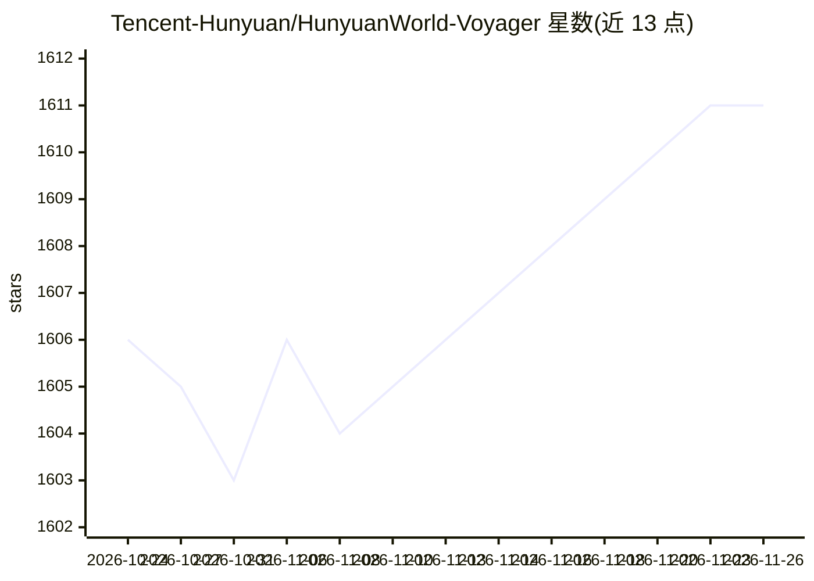

# Tencent-Hunyuan/HunyuanWorld-Voyager

⭐ 1,611 · Python · NOASSERTION · 推送 2026-11-25 · [GitHub](https://github.com/Tencent-Hunyuan/HunyuanWorld-Voyager) · [官网](https://3d-models.hunyuan.tencent.com/world/) · 组织维护 · 中文 README

**从单图按相机路径生成 3D 一致 RGBD 视频并支持 3D 重建**

腾讯混元发布的视频扩散框架，输入单张图像与用户定义的相机路径，联合生成对齐的 RGB 与深度视频序列，可直接用于 3D 重建并导出点云 ply 文件；通过世界缓存与自回归推理实现长程场景扩展。提供预训练权重（HuggingFace 下载）、单 GPU 推理、xDiT 多 GPU 并行推理与 Gradio demo，另附可生成 RGB-D 训练数据的 data engine。要求 NVIDIA CUDA GPU，540p 最低 60GB 显存，测试环境为 Linux 单卡 80G。

## 筛选速览

| 维度 | 判定 | 备注 |
|---|---|---|
| AI 角色 | `ai-native` | 本体是模型或模型工具 |
| 许可风险 | `none` | NOASSERTION |
| 部署形态 | `library` | 以包/库形式分发 |
| 模型依赖 | — | README 未给出锁定关系 |
| 硬件要求 | `gpu-24g` | |
| 安装摩擦 | `medium` | 含编译或系统依赖之一 |
| 成熟度 | — | 结构信号不足 |

## 能力要点

- 单图输入+自定义相机路径生成 3D 一致的 RGB-D 视频序列
- 支持导出 ply 点云文件用于 3D 重建
- xDiT 多 GPU 并行推理（8 卡最高 6.69x 加速）
- 附带数据引擎，可为 RGB-D 视频训练生成可扩展数据

## 适用场景

- 从单张图片生成可按相机轨迹探索的 3D 场景视频
- 从生成或实拍视频重建点云
- 估计视频深度并生成 RGB-D 序列
- 为 RGB-D 视频训练批量构建数据集

## 场景标签

`视频生成` · 领域:内容生成

## 证据(README 行号)

> L5: We introduce HunyuanWorld-Voyager, a novel video diffusion framework that generates world-consistent 3D point-cloud 
> L60: (2) Long-Range World Exploration: An efficient world cache with point culling and an auto-regressive inference with
> L156: * An NVIDIA GPU with CUDA support is required.

## 星数曲线

2026-10-24 1,606 → 2026-11-26 1,611（+5）

---
*卡片 v1 · prompt 1.4 · 生成 2026-11-26 · 置信度 mid · 依据 README sha `a2356a9dd5b5` · [字段定义](../../DATASET.md)*
