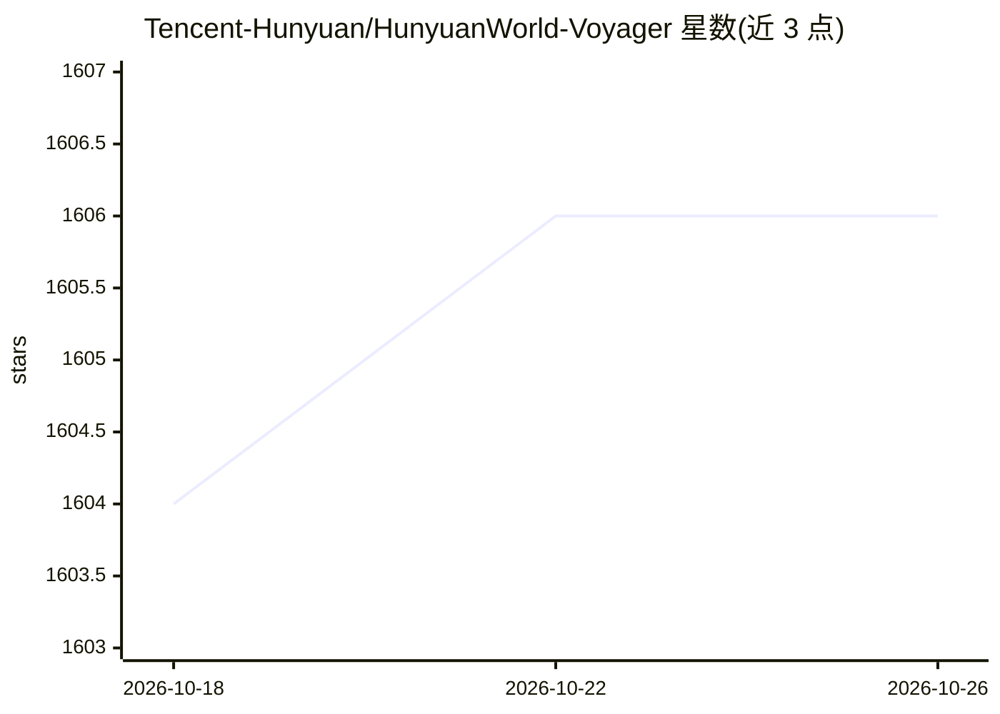

# Tencent-Hunyuan/HunyuanWorld-Voyager

⭐ 1,606 · Python · NOASSERTION · 推送 2026-04-15 · [GitHub](https://github.com/Tencent-Hunyuan/HunyuanWorld-Voyager) · [官网](https://3d-models.hunyuan.tencent.com/world/) · 组织维护 · 中文 README

**单图生成世界一致 3D 点云视频的可交互 RGBD 视频扩散模型**

腾讯混元开源的视频扩散框架：从单张图像与用户自定义相机轨迹出发，联合生成对齐的 RGB 与深度视频序列，支持长程世界探索式场景扩展，并可直接导出 3D 点云（ply）。附带数据引擎，可自动估计相机位姿与度量深度，从任意视频构建训练数据。限制明显：需要 NVIDIA GPU，540p 分辨率最低显存 60GB，推荐 80GB，测试系统为 Linux。提供 Gradio 演示与 xDiT 多卡并行推理，论文发表于 arXiv 2506.04225。

## 筛选速览

| 维度 | 判定 | 备注 |
|---|---|---|
| AI 角色 | `ai-native` | 本体是模型或模型工具 |
| 许可风险 | `none` | NOASSERTION |
| 部署形态 | `library` | 以包/库形式分发 |
| 模型依赖 | — | README 未给出锁定关系 |
| 硬件要求 | `gpu-24g` | |
| 安装摩擦 | `medium` | 含编译或系统依赖之一 |
| 成熟度 | — | 结构信号不足 |

## 能力要点

- 单图 + 相机路径联合生成对齐的 RGB 与深度视频
- 世界缓存与自回归推理支持长程场景扩展
- 附带可复用的 RGB-D 视频训练数据引擎（10 万+ 视频片段）
- 支持 xDiT 多 GPU 并行推理（8 卡延迟 288 秒，6.69x 加速）

## 适用场景

- 从一张图像沿自定义相机轨迹生成可探索的 3D 一致场景视频
- 生成 RGB-D 视频后导出点云用于 3D 重建
- 用数据引擎从自有视频构建 RGB-D 训练数据

## 场景标签

`视频生成` · 领域:内容生成

## 证据(README 行号)

> L5: We introduce HunyuanWorld-Voyager, a novel video diffusion framework that generates world-consistent 3D point-cloud 
> L58: (1) World-Consistent Video Diffusion: A unified architecture that jointly generates aligned RGB and depth video seq
> L62: To train Voyager, we propose a scalable data engine, i.e., a video reconstruction pipeline that automates camera po

## 星数曲线

2026-10-18 1,604 → 2026-10-26 1,606（+2）

---
*卡片 v1 · prompt 1.4 · 生成 2026-10-21 · 置信度 mid · 依据 README sha `3ef87d63d8d2` · [字段定义](../../DATASET.md)*
