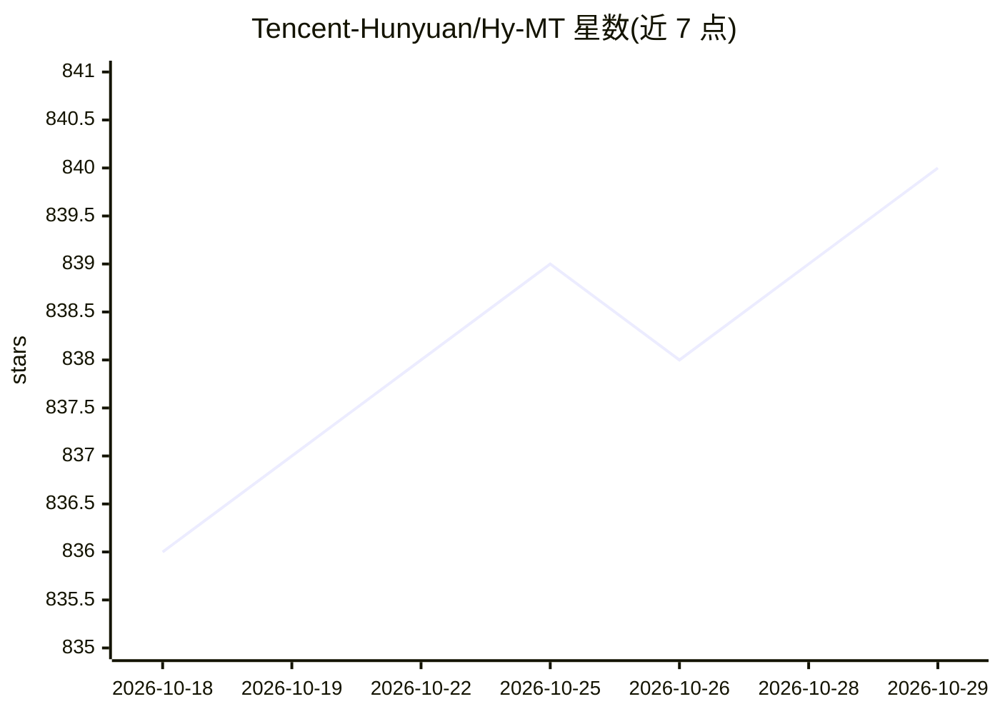

# Tencent-Hunyuan/Hy-MT

⭐ 840 · Python · NOASSERTION · 推送 2026-06-01 · [GitHub](https://github.com/Tencent-Hunyuan/Hy-MT) · 组织维护 · 中文 README

**腾讯混元开源翻译模型：33 语种互译的 1.8B/7B 权重**

腾讯混元翻译模型 v1.5 的官方仓库，提供 HY-MT1.5-1.8B 与 HY-MT1.5-7B 两款模型权重及 FP8/Int4/GGUF 量化版本，支持 33 种语言互译并含 5 种民族语言与方言变体。提供中英互译、术语干预、上下文翻译与格式化翻译的提示词模板，可用 transformers 加载推理，配合 LLaMA-Factory 微调，支持 TensorRT-LLM、vLLM、SGLang 部署为 OpenAI 兼容 API。量化后的 1.8B 版本可部署于边缘设备。

## 筛选速览

| 维度 | 判定 | 备注 |
|---|---|---|
| AI 角色 | `ai-native` | 本体是模型或模型工具 |
| 许可风险 | `none` | NOASSERTION |
| 部署形态 | `self-host` | docker 或自建部署 |
| 模型依赖 | local-ok | 支持本地模型 |
| 硬件要求 | — | 无带数字的原话,不猜 |
| 安装摩擦 | `low` | 无编译、无系统依赖或容器化 |
| 成熟度 | — | 结构信号不足 |

## 能力要点

- 1.8B 与 7B 双规格权重，含 FP8/GPTQ-Int4/GGUF 量化版本
- 33 语种互译，含藏语、蒙古语、维吾尔语、粤语等 5 种变体
- 术语干预、上下文翻译、格式化翻译提示词模板
- 官方提供 LLaMA-Factory 微调流程与 Docker 推理镜像

## 适用场景

- 搭建自托管的多语种翻译 API 服务
- 在边缘设备上做量化实时翻译
- 基于开源权重微调领域术语翻译模型

## 场景标签

`微调` · 领域:训练与推理

## 证据(README 行号)

> L21: Hunyuan Translation Model Version 1.5 includes a 1.8B translation model, HY-MT1.5-1.8B, and a 7B translation model,
> L25: - HY-MT1.5-1.8B achieves the industry-leading performance among models of the same size, surpassing most commercial
> L45: |HY-MT1.5-1.8B|Hunyuan 1.8B translation model|🤗 Model|

## 星数曲线

2026-10-18 836 → 2026-10-29 840（+4）

---
*卡片 v1 · prompt 1.4 · 生成 2026-10-21 · 置信度 mid · 依据 README sha `37bde2e02dc2` · [字段定义](../../DATASET.md)*
