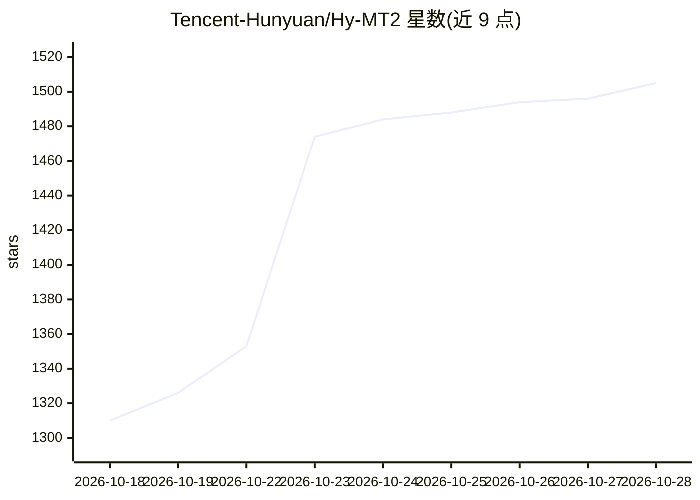

# Tencent-Hunyuan/Hy-MT2

⭐ 1,505 · Python · NOASSERTION · 推送 2026-08-26 · [GitHub](https://github.com/Tencent-Hunyuan/Hy-MT2) · 组织维护 · 中文 README

**腾讯混元 Hy-MT2 多语言翻译模型系列（1.8B/7B/30B-A3B）**

Hy-MT2 是面向复杂真实场景的“快思考”多语言翻译模型家族，提供 1.8B、7B、30B-A3B（MoE）三个规模，支持 33 种语言互译与多语言翻译指令遵循。配套发布 FP8、GGUF 及 AngelSlim 1.25-bit 极限量化版本（1.8B 压缩至 440 MB），可经 transformers、vLLM、SGLang、llama.cpp 部署推理；同时开源翻译指令跟随评测基准 IFMTBench 与训练管线（全参/LoRA 微调、LLaMA-Factory 集成）。上下文长度 8192。

## 筛选速览

| 维度 | 判定 | 备注 |
|---|---|---|
| AI 角色 | `ai-native` | 本体是模型或模型工具 |
| 许可风险 | `none` | NOASSERTION |
| 部署形态 | `library` | 以包/库形式分发 |
| 模型依赖 | local-ok | 支持本地模型 |
| 硬件要求 | — | 无带数字的原话,不猜 |
| 安装摩擦 | `medium` | 含编译或系统依赖之一 |
| 成熟度 | — | 结构信号不足 |

## 能力要点

- 1.8B/7B/30B-A3B（MoE）三个规模的翻译模型，支持 33 种语言
- AngelSlim 1.25-bit 量化将 1.8B 模型压缩至 440 MB
- 提供默认翻译、术语、风格、个性化、结构化数据等提示词模板
- 配套 IFMTBench 评测基准与全参/LoRA 训练管线

## 适用场景

- 搭建多语言机器翻译服务或本地翻译工具
- 在终端设备上用 1.25-bit 量化版做离线翻译
- 参加 WMT26 通用机器翻译与视频字幕翻译任务

## 场景标签

 · 领域:NLP/机器翻译

## 证据(README 行号)

> L14: Hy-MT2 is a family of “fast-thinking” multilingual translation models designed for complex real-world scenarios. It
> L18: In this release, we also open-source IFMTBench, a benchmark for evaluating translation instruction-following capabi

## 星数曲线

2026-10-18 1,310 → 2026-10-28 1,505（+195）

---
*卡片 v1 · prompt 1.4 · 生成 2026-10-21 · 置信度 mid · 依据 README sha `6390e4052887` · [字段定义](../../DATASET.md)*
