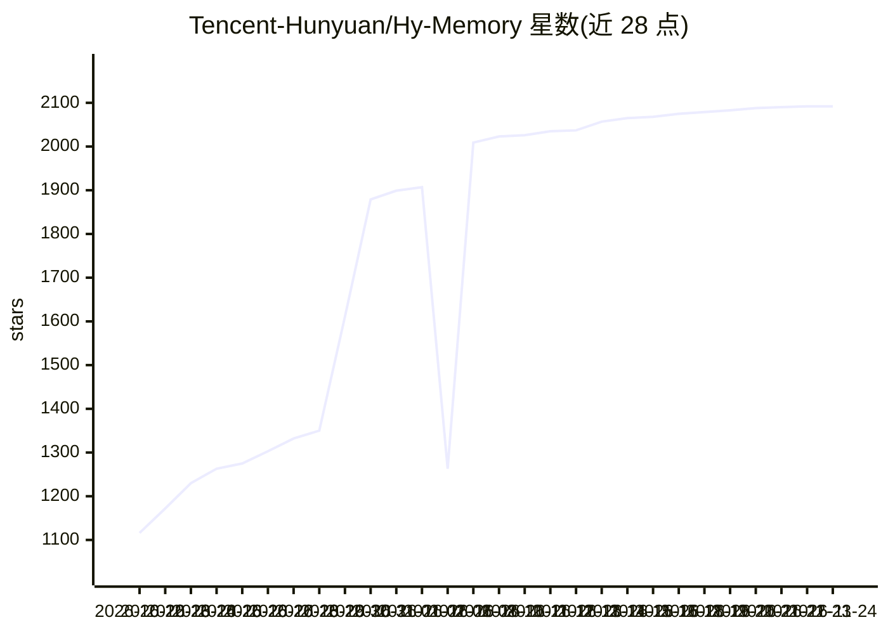

# Tencent-Hunyuan/Hy-Memory

⭐ 2,092 · Python · NOASSERTION · 推送 2026-11-21 · [GitHub](https://github.com/Tencent-Hunyuan/Hy-Memory) · 组织维护 · 中文 README

**面向 LLM Agent 的双系统认知记忆引擎与 SDK**

腾讯混元开源的 Python SDK（hy-memory）与配套桌面/CLI 产品 MemHub，为自进化 LLM Agent 提供跨 Chat、Working、Coding 三类场景的记忆管线：Chat 场景用 L0–L7 分层认知记忆，Working/Coding 场景用事实+可复现经验两层记忆，Coding 另含代码版本演化 diff 链。配置仅需一个 OpenAI 兼容的 LLM 与嵌入端点，本地运行时需通过环境变量提供 API key。以 PyPI 包分发，Apache-2.0 许可。

## 筛选速览

| 维度 | 判定 | 备注 |
|---|---|---|
| AI 角色 | `ai-ecosystem` | LLM/agent 周边工具 |
| 许可风险 | `none` | NOASSERTION |
| 部署形态 | `library` | 以包/库形式分发 |
| 模型依赖 | — | README 未给出锁定关系 |
| 硬件要求 | — | 无带数字的原话,不猜 |
| 安装摩擦 | `low` | 无编译、无系统依赖或容器化 |
| 成熟度 | — | 结构信号不足 |

## 能力要点

- 三种记忆场景：chat 分层认知、working/coding 两层事实+经验记忆
- coding 场景的版本演化 diff 链，零 LLM 调用存储每次代码变更
- lite/pro/ultra 三种模式，lite 无 LLM 调用、ultra 含 System 2 schema 归纳
- MemHub 桌面/CLI 统一管理 Claude Code、Cursor 等应用的对话与编码轨迹

## 适用场景

- 为对话型 Agent 添加长期个人记忆与冲突调和
- 为编码 Agent 保存可复用的工程经验与代码修改轨迹
- 通过 MemHub 统一管理多个 AI 编程工具的跨应用记忆召回

## 场景标签

`Agent 记忆` `Agent 框架` · 领域:Agent 开发

## 证据(README 行号)

> L5:  Production-grade dual-system cognitive memory for LLM agents.
> L20: **Hy Memory** (Official Website) is a production-grade dual-system cognitive memory engine and Python SDK (`hy-memo

## 星数曲线

2026-10-22 1,116 → 2026-11-24 2,092（+976）

---
*卡片 v1 · prompt 1.4 · 生成 2026-11-23 · 置信度 high · 依据 README sha `d580a5cf6a13` · [字段定义](../../DATASET.md)*
