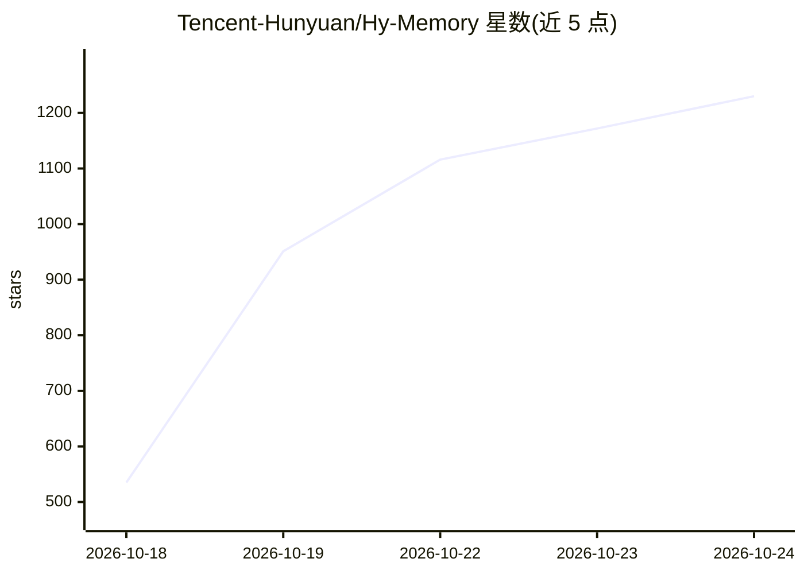

# Tencent-Hunyuan/Hy-Memory

⭐ 1,263 · Python · NOASSERTION · 推送 2026-10-24 · [GitHub](https://github.com/Tencent-Hunyuan/Hy-Memory) · 组织维护 · 中文 README

**面向自进化 LLM agent 的双系统认知记忆引擎与 Python SDK**

腾讯混元开源的认知记忆引擎与 Python SDK（hy-memory），为自进化 LLM agent 提供三类场景记忆管线：Chat 场景的 8 层（L0–L7）层级长期记忆、Working 场景的双层事实与可复用经验记忆、Coding 场景的版本演化 diff 链追踪。配置仅需任意 OpenAI 兼容的 LLM 与 embedding 端点；提供 lite/pro/ultra 三种模式（lite 零 LLM 调用），向量存储默认 ChromaDB，可选 Qdrant/FAISS，图存储用 Kuzu/Neo4j。配套 MemHub 桌面/CLI 产品统一管理跨应用记忆，另有 30B-A3B MoE 记忆写入模型与论文。

## 筛选速览

| 维度 | 判定 | 备注 |
|---|---|---|
| AI 角色 | `ai-ecosystem` | LLM/agent 周边工具 |
| 许可风险 | `none` | NOASSERTION |
| 部署形态 | `library` | 以包/库形式分发 |
| 模型依赖 | — | README 未给出锁定关系 |
| 硬件要求 | — | 无带数字的原话,不猜 |
| 安装摩擦 | `low` | 无编译、无系统依赖或容器化 |
| 成熟度 | — | 结构信号不足 |

## 能力要点

- 三场景记忆管线：Chat 8 层层级记忆、Working/Coding 双层事实+经验记忆
- Coding 版本演化 diff 链：零 LLM 调用存储每版代码真实 diff
- lite/pro/ultra 三模式，lite 零 LLM 成本，仅做向量读写
- 任意 OpenAI 兼容 LLM/embedding 端点即可运行

## 适用场景

- 为 LLM agent 接入长期个人对话记忆
- 让编码 agent 保留可复用工程经验与代码修订轨迹
- 跨 AI 应用（Claude Code/Cursor/Codex 等）统一召回记忆

## 场景标签

`Agent 记忆` · 领域:Agent 开发

## 证据(README 行号)

> L20: **Hy Memory** (Official Website) is a production-grade dual-system cognitive memory engine and Python SDK (`hy-memo
> L55: pip install hy-memory==2.0.3              # core (includes ChromaDB and Kuzu)
> L83: from hy_memory import HyMemoryClient

## 星数曲线

2026-10-18 535 → 2026-10-24 1,230（+695）

---
*卡片 v1 · prompt 1.4 · 生成 2026-10-21 · 置信度 high · 依据 README sha `992bd30ec228` · [字段定义](../../DATASET.md)*
