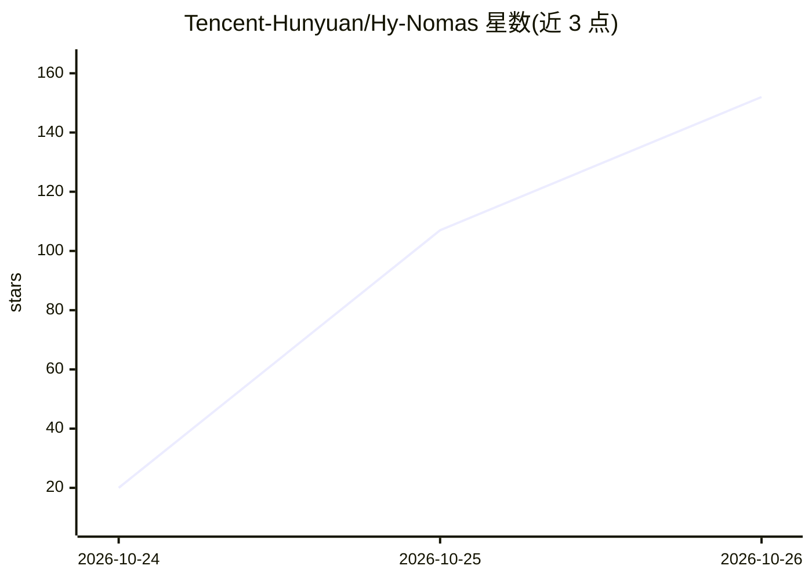

# Tencent-Hunyuan/Hy-Nomas

⭐ 152 · Python · NOASSERTION · 推送 2026-10-24 · [GitHub](https://github.com/Tencent-Hunyuan/Hy-Nomas) · 组织维护 · 中文 README

**自由形式交互式视频世界生成模型，支持多轮文本与相机控制**

腾讯混元发布的自由形式交互式视频世界生成模型：以段为单位自回归生成，支持任意形式的用户文本提示（物体、风格、场景、动作）与相机轨迹控制，通过终身 KV 缓存保持多段一致性；推理经蒸馏仅需 8 步去噪，使用 DCAE-V 视频自编码器与微调 PixelUMM 解码器。仓库提供训练、推理、Web 交互 Demo 与数据标注代码，支持 LoRA 微调与单卡 RTX 4090 低显存推理（INT8 权重、CPU offload）。需要 NVIDIA GPU 与 CUDA 13.0 环境。

## 筛选速览

| 维度 | 判定 | 备注 |
|---|---|---|
| AI 角色 | `ai-native` | 本体是模型或模型工具 |
| 许可风险 | `none` | NOASSERTION |
| 部署形态 | `self-host` | docker 或自建部署 |
| 模型依赖 | — | README 未给出锁定关系 |
| 硬件要求 | — | 无带数字的原话,不猜 |
| 安装摩擦 | `low` | 无编译、无系统依赖或容器化 |
| 成熟度 | — | 结构信号不足 |

## 能力要点

- 段级自回归世界生成，支持自由文本提示与相机轨迹控制
- 蒸馏推理 8 步去噪，基于 DCAE-V 32 通道潜变量
- 单张 RTX 4090 低显存推理（INT8 权重、滑窗历史、CPU offload）
- 提供 LoRA 微调流水线与本地视频数据标注工作流

## 适用场景

- 多轮交互式生成想象的虚拟世界视频
- 用自定义视频数据集微调专属世界生成模型
- 机器人仿真场景生成（Robotics LoRA）

## 场景标签

`视频生成` `微调` · 领域:内容生成

## 证据(README 行号)

> L25: **Hy-Nomas** is a free-form interactive video world generation model. It supports free-form multi-turn text prompt 
> L29: - **Segment-based generation:** Autoregressive segment-wise world generation controlled by either segment level pro

## 星数曲线

2026-10-24 20 → 2026-10-26 152（+132）

---
*卡片 v1 · prompt 1.4 · 生成 2026-10-24 · 置信度 mid · 依据 README sha `bcc7fca8220a` · [字段定义](../../DATASET.md)*
