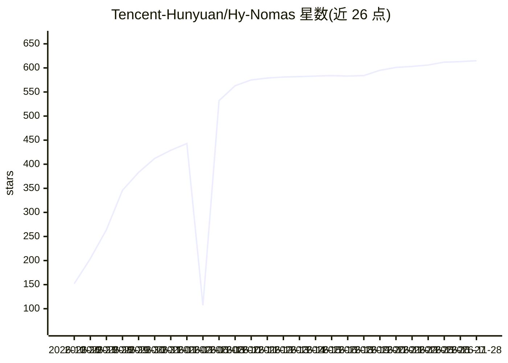

# Tencent-Hunyuan/Hy-Nomas

⭐ 615 · Python · NOASSERTION · 推送 2026-11-12 · [GitHub](https://github.com/Tencent-Hunyuan/Hy-Nomas) · 组织维护 · 中文 README

**多轮文本与相机控制的可交互世界生成模型**

腾讯混元发布的自回归分段式世界生成模型，支持自由格式多轮文本提示与相机轨迹控制，通过终身 KV 缓存保持跨段一致性。仓库提供训练、推理、交互式 Web demo 与数据标注代码；推理蒸馏至 4-8 步去噪，INT8 量化与 CPU offload 实现单张 RTX 4090 低显存推理，支持 LoRA 微调。推荐 Docker 镜像部署，也可用 uv 手动安装；提供 Diffusers 与 SGLang 推理路径。附 Hy-Nomas-Bench 基准与技术报告。

## 筛选速览

| 维度 | 判定 | 备注 |
|---|---|---|
| AI 角色 | `ai-native` | 本体是模型或模型工具 |
| 许可风险 | `none` | NOASSERTION |
| 部署形态 | `self-host` | docker 或自建部署 |
| 模型依赖 | — | README 未给出锁定关系 |
| 硬件要求 | — | 无带数字的原话,不猜 |
| 安装摩擦 | `low` | 无编译、无系统依赖或容器化 |
| 成熟度 | — | 结构信号不足 |

## 能力要点

- 多轮文本与相机轨迹控制的自回归分段世界生成
- INT8 权重+滑动窗口+CPU offload 支持单卡 RTX 4090 推理
- LoRA 微调与本地视频数据标注工作流
- 提供 Diffusers 管线与 SGLang 实时流式服务

## 适用场景

- 生成可交互探索的想象世界视频
- 机器人仿真的世界模型微调（Robotics LoRA）
- 微短剧等互动内容生成

## 场景标签

`视频生成` `微调` `模型量化` · 领域:内容生成

## 证据(README 行号)

> L7: **Hy-Nomas** is a free-form interactive world generation model controlled by multi-turn text and camera inputs. It r
> L62: **Hy-Nomas** is a free-form interactive video world generation model. It supports free-form multi-turn text prompt 

## 星数曲线

2026-10-26 152 → 2026-11-28 615（+463）

---
*卡片 v1 · prompt 1.4 · 生成 2026-11-25 · 置信度 mid · 依据 README sha `3475257c31da` · [字段定义](../../DATASET.md)*
