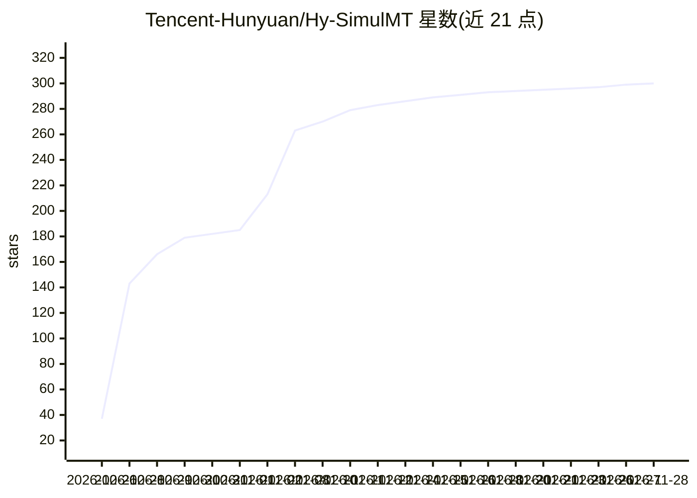

# Tencent-Hunyuan/Hy-SimulMT

⭐ 300 · Python · NOASSERTION · 推送 2026-10-27 · [GitHub](https://github.com/Tencent-Hunyuan/Hy-SimulMT) · 组织维护 · 中文 README

**腾讯混元中英双向实时同声传译模型，边听边译并保留说话人音色**

腾讯混元开发的中英双向语音到语音实时同声传译模型：接收连续音频流，在说话过程中持续输出译文文本与语音，并支持实时声音克隆以保留说话人音色。仓库提供 SimulInfer 推理服务与 SimulTrain 训练工具；语音输出与克隆需配置 TTS 服务。模型提供 30B-A3B 基础版及 FP8 量化、GGUF、源文-译文交错输出等变体，可通过 Hugging Face/ModelScope 下载，也可在 Hy Translate App 中试用。

## 筛选速览

| 维度 | 判定 | 备注 |
|---|---|---|
| AI 角色 | `ai-native` | 本体是模型或模型工具 |
| 许可风险 | `none` | NOASSERTION |
| 部署形态 | `self-host` | docker 或自建部署 |
| 模型依赖 | local-ok | 支持本地模型 |
| 硬件要求 | — | 无带数字的原话,不猜 |
| 安装摩擦 | `low` | 无编译、无系统依赖或容器化 |
| 成熟度 | — | 结构信号不足 |

## 能力要点

- 中英双向实时同声传译：音频流输入，边讲边输出译文文本与语音
- 实时声音克隆，保留说话人音色特征
- 提供 SimulInfer 推理服务与 SimulTrain 训练工具
- 模型提供 FP8 量化与 GGUF 格式等多个变体

## 适用场景

- 会议、演讲、访谈等场景的实时中英互译
- 需要保留说话人声音特征的同传直播或字幕
- 自建同传推理服务并进行模型训练定制
- 通过 Hy Translate App 在手机上试用同传

## 场景标签

`模型训练` · 领域:训练与推理

## 证据(README 行号)

> L15: **Hy-SimulMT** is a real-time simultaneous translation model developed by Tencent Hunyuan, supporting **bidirection
> L21: This repository provides the **SimulInfer inference service** and **SimulTrain training tools**. Speech output and 
> L151: |Hy-SimulMT-30B-A3B|Hunyuan simultaneous translation model, translation-only output|Model|

## 星数曲线

2026-10-26 37 → 2026-11-28 300（+263）

---
*卡片 v1 · prompt 1.4 · 生成 2026-11-25 · 置信度 high · 依据 README sha `646b02b52a7d` · [字段定义](../../DATASET.md)*
