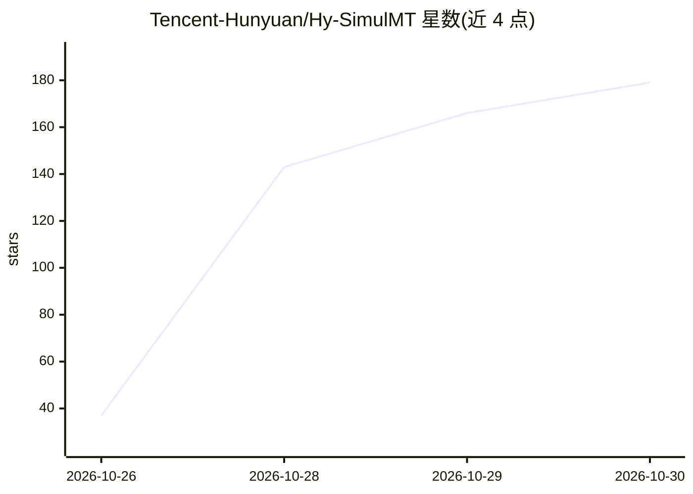

# Tencent-Hunyuan/Hy-SimulMT

⭐ 179 · Python · NOASSERTION · 推送 2026-10-27 · [GitHub](https://github.com/Tencent-Hunyuan/Hy-SimulMT) · 组织维护 · 中文 README

**腾讯混元中英双向实时同声传译模型，边说边译并克隆音色**

腾讯混元开发的中英双向语音到语音实时同声传译模型：持续接收音频流，边说边译，同时输出译文文本与语音，并支持实时音色克隆以保留说话人声音特征。面向会议、演讲、访谈等实时交流场景。仓库提供 SimulInfer 推理服务与 SimulTrain 训练工具，语音输出与音色克隆需自行配置 TTS 服务；模型提供 30B-A3B 的原版、FP8 与 GGUF 等多个版本，另有 Hy Translate App 供终端用户体验。评测基于 RealSI 等公开基准并与专业同传译员做了小规模对照。

## 筛选速览

| 维度 | 判定 | 备注 |
|---|---|---|
| AI 角色 | `ai-native` | 本体是模型或模型工具 |
| 许可风险 | `none` | NOASSERTION |
| 部署形态 | `library` | 以包/库形式分发 |
| 模型依赖 | local-ok | 支持本地模型 |
| 硬件要求 | — | 无带数字的原话,不猜 |
| 安装摩擦 | `medium` | 含编译或系统依赖之一 |
| 成熟度 | — | 结构信号不足 |

## 能力要点

- 中英双向流式语音到语音同声传译，边说边译
- 实时音色克隆，保留说话人声音特征
- 提供 SimulInfer 推理服务与 SimulTrain 训练工具
- 模型提供 FP8 量化与 GGUF 格式版本

## 适用场景

- 跨国会议、演讲、访谈中的中英实时互译
- 希望译文语音保留原说话人音色的跨语言交流
- 在自有服务中部署或继续训练同声传译模型

## 场景标签

 · 领域:语音翻译/大模型

## 证据(README 行号)

> L15: **Hy-SimulMT** is a real-time simultaneous translation model developed by Tencent Hunyuan, supporting **bidirection
> L21: This repository provides the **SimulInfer inference service** and **SimulTrain training tools**. Speech output and 

## 星数曲线

2026-10-26 37 → 2026-10-30 179（+142）

---
*卡片 v1 · prompt 1.4 · 生成 2026-10-27 · 置信度 mid · 依据 README sha `703050b13efc` · [字段定义](../../DATASET.md)*
