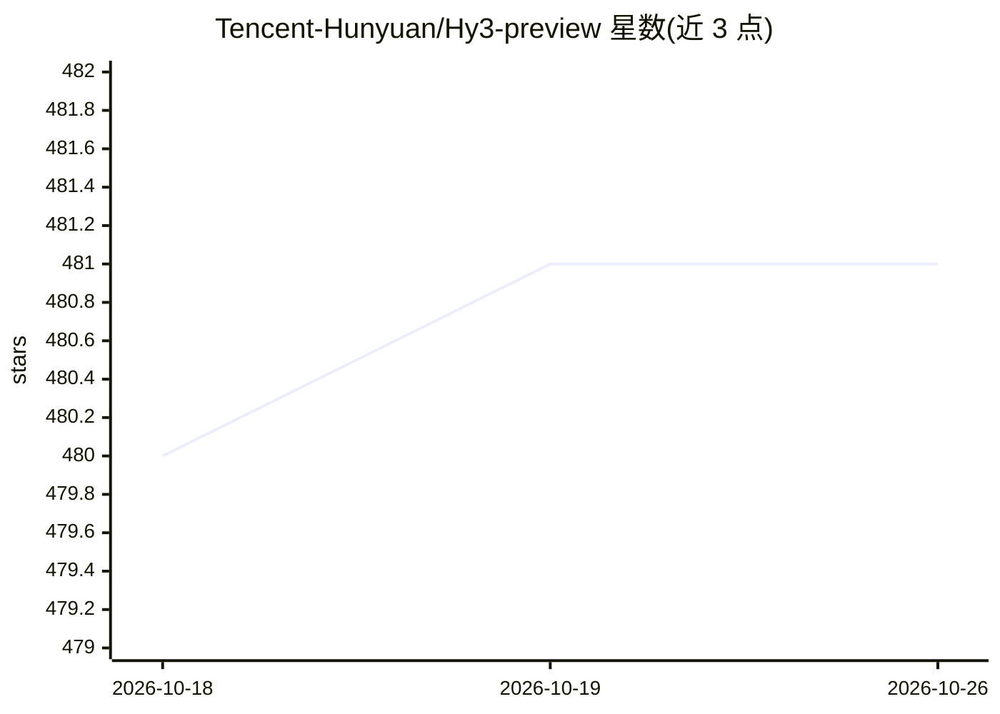

# Tencent-Hunyuan/Hy3-preview

⭐ 481 · Python · NOASSERTION · 推送 2026-04-23 · [GitHub](https://github.com/Tencent-Hunyuan/Hy3-preview) · 组织维护 · 中文 README

**腾讯 295B MoE 推理与 Agent 大模型权重（Hy3 preview）**

腾讯 Hy 团队开源的 Hy3 preview 模型权重：295B 总参数、21B 激活参数的 MoE 架构，含 3.8B MTP 层参数，上下文长度 256K，BF16 精度。面向复杂推理、指令跟随、上下文学习、编码与 Agent 任务。部署方式为先用 vLLM 或 SGLang 起服务（源码构建，推荐 8 卡 GPU 如 H20-3e），再通过 OpenAI 兼容 API 调用；提供全参/LoRA 微调流程与 AngelSlim 量化工具，权重发布在 Hugging Face/ModelScope/GitCode。许可证为 Tencent Hy Community License Agreement。

## 筛选速览

| 维度 | 判定 | 备注 |
|---|---|---|
| AI 角色 | `ai-native` | 本体是模型或模型工具 |
| 许可风险 | `none` | NOASSERTION |
| 部署形态 | `library` | 以包/库形式分发 |
| 模型依赖 | local-ok | 支持本地模型 |
| 硬件要求 | — | 无带数字的原话,不猜 |
| 安装摩擦 | `low` | 无编译、无系统依赖或容器化 |
| 成熟度 | `idea` | |

## 能力要点

- 295B MoE（21B 激活）模型权重开源，上下文 256K
- 支持 vLLM 与 SGLang 部署，OpenAI 兼容 API，MTP 投机解码
- 提供全参微调与 LoRA 微调流程（DeepSpeed ZeRO、LLaMA-Factory）
- 提供 reasoning_effort 推理模式（high / no_think）

## 适用场景

- 自建推理服务处理数学、编码、Agent 等复杂任务
- 长上下文指令跟随类业务场景
- 在开源权重上做微调或量化后部署

## 场景标签

`微调` · 领域:训练与推理

## 证据(README 行号)

> L20: **Hy3 preview** is a 295B-parameter Mixture-of-Experts (MoE) model with 21B active parameters and 3.8B MTP layer pa
> L116: Deploy Hy3 preview with vLLM or SGLang first, then call the OpenAI-compatible API:

## 星数曲线

2026-10-18 480 → 2026-10-26 481（+1）

---
*卡片 v1 · prompt 1.4 · 生成 2026-10-21 · 置信度 mid · 依据 README sha `b55cc7bb69e7` · [字段定义](../../DATASET.md)*
