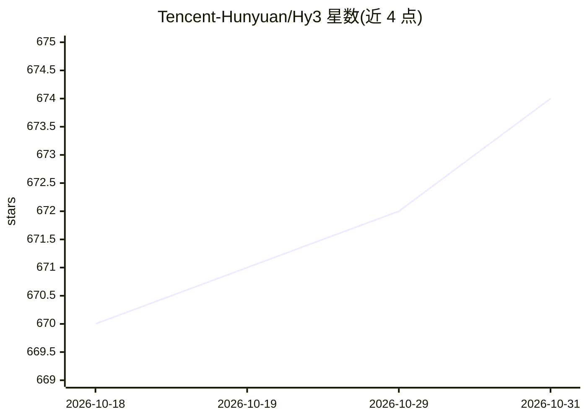

# Tencent-Hunyuan/Hy3

⭐ 674 · Python · NOASSERTION · 推送 2026-07-17 · [GitHub](https://github.com/Tencent-Hunyuan/Hy3) · 组织维护 · 中文 README

**腾讯开源的 295B MoE 推理与 Agent 模型权重**

腾讯 Hy Team 发布的开源大语言模型：295B 总参数 MoE 架构，21B 激活参数，含 3.8B MTP 层参数，上下文长度 256K，支持 BF16 与 FP8 量化版本。面向推理、Agent、长上下文与编码、办公、前端等生产力场景。通过 vLLM 或 SGLang 部署后以 OpenAI 兼容 API 调用；提供微调管线、基于 verl/Megatron-LM 的 GRPO 强化学习训练方案，以及 AngelSlim 压缩工具包。服务需 8 卡大显存 GPU（如 H20-3e）。Apache 2.0 许可。

## 筛选速览

| 维度 | 判定 | 备注 |
|---|---|---|
| AI 角色 | `ai-native` | 本体是模型或模型工具 |
| 许可风险 | `none` | NOASSERTION |
| 部署形态 | `library` | 以包/库形式分发 |
| 模型依赖 | local-ok | 支持本地模型 |
| 硬件要求 | — | 无带数字的原话,不猜 |
| 安装摩擦 | `low` | 无编译、无系统依赖或容器化 |
| 成熟度 | — | 结构信号不足 |

## 能力要点

- 295B MoE（21B 激活），256K 上下文，MTP 层 3.8B
- 提供 Hy3 与 Hy3-FP8 两个模型权重版本（HF/ModelScope/GitCode/CNB）
- vLLM/SGLang 专用部署方案，OpenAI 兼容 API 与 reasoning_effort 模式
- 微调管线、verl GRPO 强化学习训练与 AngelSlim 量化工具

## 适用场景

- 自建推理服务，通过 OpenAI 兼容 API 调用模型
- 在编码、前端、数据处理等 Agent 场景中做生产部署
- 基于开源权重做微调或 GRPO 强化学习后训练

## 场景标签

`微调` `强化学习` `模型量化` · 领域:训练与推理

## 证据(README 行号)

> L20: **Hy3** is a 295B-parameter Mixture-of-Experts (MoE) model with 21B active parameters and 3.8B MTP layer parameters
> L71: Deploy Hy3 with vLLM or SGLang first, then call the OpenAI-compatible API:

## 星数曲线

2026-10-18 670 → 2026-10-31 674（+4）

---
*卡片 v1 · prompt 1.4 · 生成 2026-10-21 · 置信度 mid · 依据 README sha `26a533f42530` · [字段定义](../../DATASET.md)*
