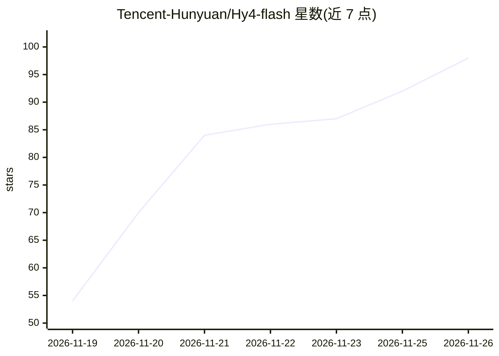

# Tencent-Hunyuan/Hy4-flash

⭐ 98 · Python · NOASSERTION · 推送 2026-11-18 · [GitHub](https://github.com/Tencent-Hunyuan/Hy4-flash) · 组织维护 · 中文 README

**腾讯开源的多模态 MoE 模型：文本图像输入、文本生成**

腾讯混元发布的开放权重模型系列（Hy4 flash / FP8 / base），总参数 220B、每 token 激活约 12B，接受文本与图像输入并生成文本，上下文窗口 1M tokens。架构采用混合注意力（稀疏+滑窗）、LatentMoE、N-gram 嵌入（Engram），内置 0.85B 投机解码 drafter DFly2 复用 KV cache。可通过 Transformers 本地推理或 vLLM 部署服务并以 OpenAI 兼容 API 访问；权重发布在 Hugging Face、ModelScope、GitCode，另提供 GGUF 版本链接。

## 筛选速览

| 维度 | 判定 | 备注 |
|---|---|---|
| AI 角色 | `ai-native` | 本体是模型或模型工具 |
| 许可风险 | `none` | NOASSERTION |
| 部署形态 | `self-host` | docker 或自建部署 |
| 模型依赖 | local-ok | 支持本地模型 |
| 硬件要求 | — | 无带数字的原话,不猜 |
| 安装摩擦 | `low` | 无编译、无系统依赖或容器化 |
| 成熟度 | — | 结构信号不足 |

## 能力要点

- 1M tokens 上下文窗口，文本+图像输入
- 220B 总参数、12B 激活的 MoE 架构
- DFly2 投机解码复用 KV cache，无额外 KV 内存
- 提供 Instruct、FP8 量化与 base 三种权重

## 适用场景

- 部署 OpenAI 兼容 API 服务多模态问答
- 本地用 Transformers 加载模型做图像描述生成
- 日常办公任务：深度搜索、文档处理、幻灯片制作

## 场景标签

`多模态` · 领域:感知与多模态

## 证据(README 行号)

> L21: **Hy4 flash** is our most cost-effective Hy model to date, featuring 220B total parameters (including 64B Engram pa
> L184: Use Transformers to load the model for local inference, or deploy a server and access it through the OpenAI-compat

## 星数曲线

2026-11-19 54 → 2026-11-26 98（+44）

---
*卡片 v1 · prompt 1.4 · 生成 2026-11-19 · 置信度 mid · 依据 README sha `c80c68258a8b` · [字段定义](../../DATASET.md)*
