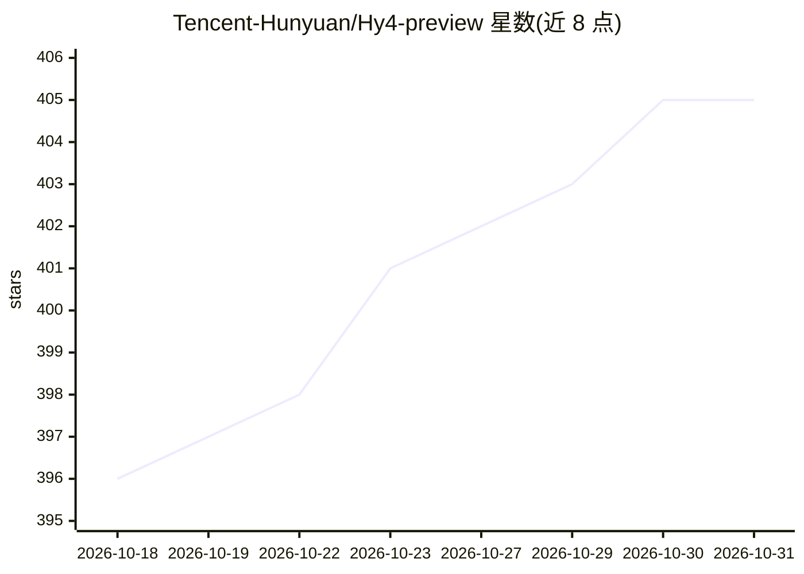

# Tencent-Hunyuan/Hy4-preview

⭐ 405 · Python · NOASSERTION · 推送 2026-08-28 · [GitHub](https://github.com/Tencent-Hunyuan/Hy4-preview) · 组织维护 · 中文 README

**腾讯混元团队的 770B MoE 旗舰大模型（49B 激活）**

Hy4 preview 是腾讯混元团队开源的 Mixture-of-Experts 大语言模型：770B 总参数、每 token 激活 49B，78 层骨干（77 层 MoE，256 路由专家取 top-8 加 1 共享专家），内置 10B 参数 MTP 层用于投机解码，注意力采用 Gated DSA，上下文 1M。面向需要长上下文推理、软件工程、办公分析、游戏开发与科研任务的开发者与研究者。以 Apache 2.0 许可在 Hugging Face/ModelScope 等平台发布权重，提供 vLLM/SGLang 官方镜像部署、OpenAI 兼容 API、微调指南与 AngelSlim 量化工具链。自述为早期版本，存在已知问题。

## 筛选速览

| 维度 | 判定 | 备注 |
|---|---|---|
| AI 角色 | `ai-native` | 本体是模型或模型工具 |
| 许可风险 | `none` | NOASSERTION |
| 部署形态 | `self-host` | docker 或自建部署 |
| 模型依赖 | local-ok | 支持本地模型 |
| 硬件要求 | — | 无带数字的原话,不猜 |
| 安装摩擦 | `low` | 无编译、无系统依赖或容器化 |
| 成熟度 | `idea` | |

## 能力要点

- 770B 总参数 / 49B 激活的 MoE 架构，1M 上下文长度
- 内置 MTP 层（10B 参数）支持投机解码
- 提供 vLLM / SGLang 官方预构建 Docker 镜像与 OpenAI 兼容 API
- 配套微调管线与 AngelSlim 量化工具链

## 适用场景

- 用 vLLM/SGLang 自建推理服务获得 OpenAI 兼容接口
- 处理软件工程、长文档分析、科研推理等长周期任务
- 在 FP8 量化版本上做低资源部署或用 AngelSlim 进一步压缩

## 场景标签

 · 领域:大语言模型

## 证据(README 行号)

> L20: **Hy4 preview** is a new-generation Mixture-of-Experts (MoE) flagship model developed by the Tencent Hy Team. The m
> L139: Hy4 preview is released under the **Apache License 2.0**. See LICENSE for details.

## 星数曲线

2026-10-18 396 → 2026-10-31 405（+9）

---
*卡片 v1 · prompt 1.4 · 生成 2026-10-21 · 置信度 high · 依据 README sha `d845e0986c06` · [字段定义](../../DATASET.md)*
