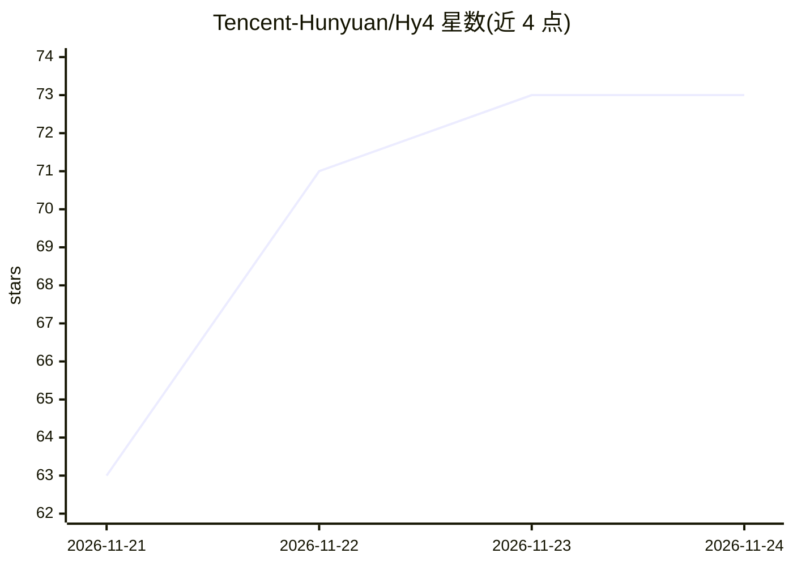

# Tencent-Hunyuan/Hy4

⭐ 73 · Python · NOASSERTION · 推送 2026-11-20 · [GitHub](https://github.com/Tencent-Hunyuan/Hy4) · 组织维护 · 中文 README

**腾讯混元 770B MoE 开源多模态大模型权重发布**

腾讯混元团队发布的开源权重模型仓库：提供 Hy4（Instruct）、Hy4-FP8（量化）与 Hy4 base 三个权重的下载入口（Hugging Face/ModelScope/GitCode），并附模型规格表、预训练基准评测、部署方法（vLLM/SGLang 启动 OpenAI 兼容 API）与量化工具链说明。面向需要自行部署或研究该模型架构的开发者与研究人员；README 未提供在线服务，部署需大显存环境。

## 筛选速览

| 维度 | 判定 | 备注 |
|---|---|---|
| AI 角色 | `ai-native` | 本体是模型或模型工具 |
| 许可风险 | `none` | NOASSERTION |
| 部署形态 | `self-host` | docker 或自建部署 |
| 模型依赖 | local-ok | 支持本地模型 |
| 硬件要求 | — | 无带数字的原话,不猜 |
| 安装摩擦 | `low` | 无编译、无系统依赖或容器化 |
| 成熟度 | — | 结构信号不足 |

## 能力要点

- 770B 总参数 / 每 token 49B 激活的 MoE 架构，上下文长度 1M tokens
- 支持文本、图像、视频理解，附 1.23B ViT 视觉编码器
- 内置 DFly2 3.3B 投机解码 drafter，复用 KV cache 与稀疏索引
- 提供 FP8 量化权重及 AngelSlim 压缩工具包

## 适用场景

- 自建推理服务处理长文本与多模态理解任务
- 研究 MoE、稀疏注意力与投机解码架构
- 金融/办公/前端/游戏开发等工作流任务的本地化部署

## 场景标签

`多模态` `推理引擎` `模型量化` · 领域:感知与多模态

## 证据(README 行号)

> L19: **Hy4** is a new-generation Mixture-of-Experts (MoE) flagship model developed by the Tencent Hy Team, supporting te
> L173: Deploy Hy4 with vLLM or SGLang first, then call the OpenAI-compatible API:

## 星数曲线

2026-11-21 63 → 2026-11-24 73（+10）

---
*卡片 v1 · prompt 1.4 · 生成 2026-11-21 · 置信度 high · 依据 README sha `799b86862943` · [字段定义](../../DATASET.md)*
