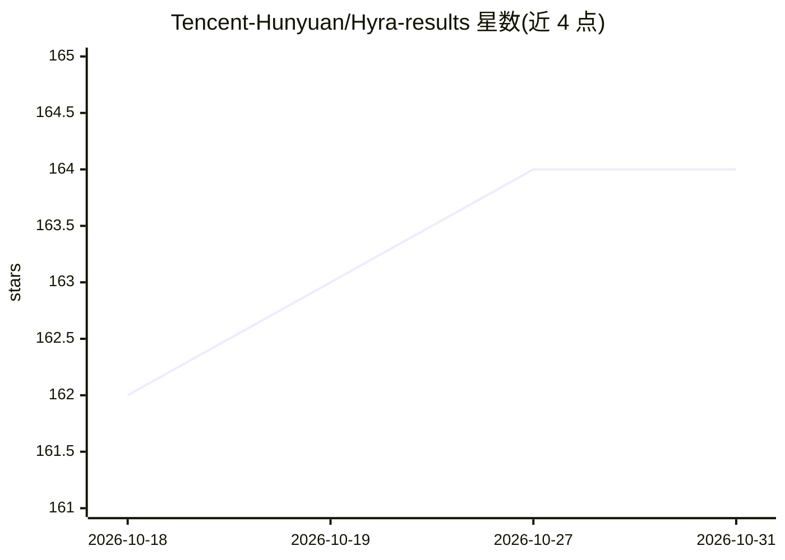

# Tencent-Hunyuan/Hyra-results

⭐ 164 · Python · NOASSERTION · 推送 2026-08-19 · [GitHub](https://github.com/Tencent-Hunyuan/Hyra-results) · [官网](https://hy.tencent.com/research/hyra) · 组织维护 · 中文 README

**Hyra 研究 Agent 的成果仓库：科学/工程问题的解与复现脚本**

腾讯混元 Hyra（Hunyuan Research Agent）发布文章的配套成果仓库：收录该 agent 在科学、数学、工程与创意设计等开放问题上产出的最终解工件与自包含复现脚本。内容含 AI4Science 系列论文（Beurling–Ahlfors 变换系数、部分 Hadamard 矩阵计数、三维 Blaschke–Lebesgue 下界等）、AI4AI 自动研究跑分对比表，以及 AI4Fun 创意演示（黑白棋 bot、编曲、Blender 程序化建模）。仓库仅作成果发布，不含本产品安装命令；结果截至 2026-07-10 起分批更新。Apache-2.0 许可。

## 筛选速览

| 维度 | 判定 | 备注 |
|---|---|---|
| AI 角色 | `ai-knowledge` | 知识聚合/清单类 |
| 许可风险 | `none` | NOASSERTION |
| 部署形态 | `None` |  |
| 模型依赖 | — | README 未给出锁定关系 |
| 硬件要求 | — | 无带数字的原话,不猜 |
| 安装摩擦 | `low` | 无编译、无系统依赖或容器化 |
| 成熟度 | — | 结构信号不足 |

## 能力要点

- AI4Science 16 项任务结果与此前最优公开结果的对比表
- 每项结果附论文目录与自包含复现脚本
- AI4Fun 创意演示：AlphaZero 风格黑白棋 bot、五声部编曲、Blender 程序化建模
- 明确标注结果时效与公开排行榜的 warm-start 后续可能性

## 适用场景

- 查阅 Hyra agent 在数学与科学开放问题上的产出与对比数据
- 获取各结果的论文与复现脚本
- 跟踪 AI for Science 自动研究的基准表现

## 场景标签

`科研工具` `模型评测` · 领域:评测与运维

## 证据(README 行号)

> L3: Companion artifacts for **Hyra**: **H**un**y**uan **R**esearch **A**gent.
> L5: This repository collects concrete solutions that Hyra produced across a range of
> L7: released alongside the Hyra launch post. Each folder holds the final solution

## 星数曲线

2026-10-18 162 → 2026-10-31 164（+2）

---
*卡片 v1 · prompt 1.4 · 生成 2026-10-22 · 置信度 high · 依据 README sha `afdd20a9cd64` · [字段定义](../../DATASET.md)*
