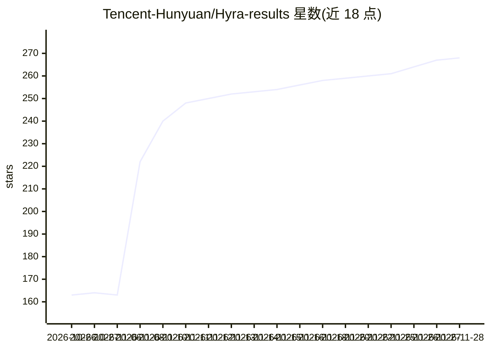

# Tencent-Hunyuan/Hyra-results

⭐ 268 · Python · NOASSERTION · 推送 2026-11-14 · [GitHub](https://github.com/Tencent-Hunyuan/Hyra-results) · [官网](https://hy.tencent.com/research/hyra) · 组织维护

**腾讯混元 Hyra 研究智能体的成果工件集：科学/数学问题解法与模型**

该仓库是 Hyra（Hunyuan Research Agent）的配套成果库，收集其在科学、数学、工程与创意设计等开放问题上产出的具体解法：包含数学猜想的论文与 Lean 4 形式化、SAT 证明与可复算证书，以及带权重和代码的模型（PDE 基础模型 HyPDE、单细胞嵌入模型 HyCell、分子力场 HyFF、蛋白质模型 HyInv/HyPLM-Flash）。各文件夹存放最终解工件及自包含的复现脚本，并附与已发表先前结果的对照表。

## 筛选速览

| 维度 | 判定 | 备注 |
|---|---|---|
| AI 角色 | `ai-knowledge` | 知识聚合/清单类 |
| 许可风险 | `none` | NOASSERTION |
| 部署形态 | `None` |  |
| 模型依赖 | — | README 未给出锁定关系 |
| 硬件要求 | — | 无带数字的原话,不猜 |
| 安装摩擦 | `low` | 无编译、无系统依赖或容器化 |
| 成熟度 | — | 结构信号不足 |

## 能力要点

- 收集 Hyra 在科学、数学、工程、创意设计问题上的解法工件及复现脚本
- 发布多个带权重与代码的模型：HyPDE（323M）、HyCell（16.1M）、HyFF 力场系列、HyInv/HyPLM-Flash
- 数学成果附 Lean 4 形式化、drat-trim 校验的 SAT 证明与可复算证书
- 提供与已发表先前最优结果的逐项指标对照表

## 适用场景

- 查看 AI 研究智能体在各学科开放问题上的产出成果
- 下载并复现 PDE、单细胞、分子模拟等 AI4Science 模型权重
- 查阅数学猜想结果的论文、形式化证明与证书

## 场景标签

`科研工具` · 领域:学习与行业

## 证据(README 行号)

> L5: This repository collects concrete solutions that Hyra produced across a range of
> L7: released alongside the Hyra launch post. Each folder holds the final solution
> L79: - **2026-08-19**: 🧾 **Three new results, each with a Lean 4 formalization of its

## 星数曲线

2026-10-26 163 → 2026-11-28 268（+105）

---
*卡片 v1 · prompt 1.4 · 生成 2026-11-25 · 置信度 high · 依据 README sha `5de1e068ad49` · [字段定义](../../DATASET.md)*
