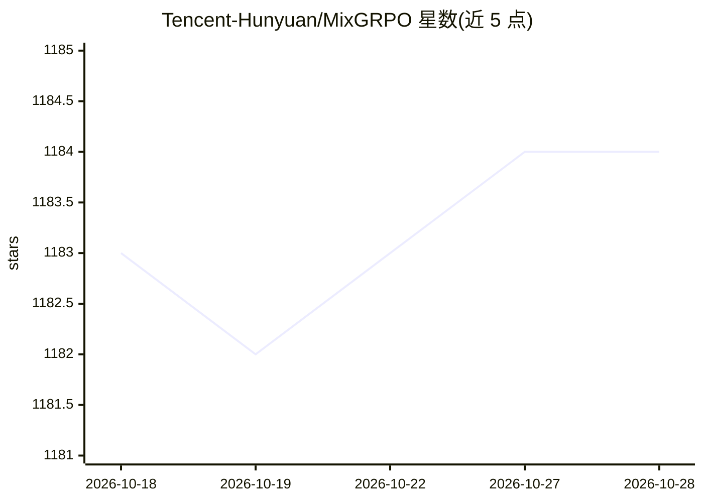

# Tencent-Hunyuan/MixGRPO

⭐ 1,184 · Python · NOASSERTION · 推送 2026-07-01 · [GitHub](https://github.com/Tencent-Hunyuan/MixGRPO) · [官网](https://tulvgengenr.github.io/MixGRPO-Project-Page/) · 组织维护 · 中文 README

**面向流式扩散模型的混合 ODE-SDE GRPO 强化学习后训练算法**

腾讯混元与北京大学团队的 ECCV 2026 论文官方实现：提出 MixGRPO，将混合 ODE-SDE 采样引入基于流的 GRPO 强化学习后训练，并支持 Coefficients-Preserving Sampling（CPS）。提供 FLUX.1 Dev 微调的完整流程：conda 环境搭建、多奖励模型（HPSv2/ImageReward/PickScore/CLIP）准备、提示数据预处理、基于 pdsh+torchrun 的多节点训练（默认 4 节点 32 GPU）、推理与奖励评估脚本，并在 HuggingFace 发布微调后的模型权重。依赖与 DanceGRPO 基本相同。

## 筛选速览

| 维度 | 判定 | 备注 |
|---|---|---|
| AI 角色 | `ai-ecosystem` | LLM/agent 周边工具 |
| 许可风险 | `none` | NOASSERTION |
| 部署形态 | `None` |  |
| 模型依赖 | — | README 未给出锁定关系 |
| 硬件要求 | — | 无带数字的原话,不猜 |
| 安装摩擦 | `medium` | 含编译或系统依赖之一 |
| 成熟度 | — | 结构信号不足 |

## 能力要点

- 混合 ODE-SDE 采样的 Flow-based GRPO 训练算法（ECCV 2026）
- 支持 HPSv2/ImageReward/PickScore/CLIP 多奖励模型组合
- 提供多节点训练、推理与评估完整脚本链
- 发布基于 FLUX.1 Dev 微调的模型权重

## 适用场景

- 研究者复现或扩展 Flow-based GRPO 后训练方法
- 用多奖励强化学习微调文本到图像扩散模型
- 对比 Flow-GRPO/Flow-DPO 等同类训练方法

## 场景标签

`强化学习` `微调` · 领域:训练与推理

## 证据(README 行号)

> L1: MixGRPO: Unlocking Flow-based GRPO Efficiency with Mixed ODE-SDE
> L30: - [2025/7/30] We released the model checkpoint fine-tuned based on FLUX.1 Dev using the MixGRPO algorithm, with HPS
> L111: We use the `"pdsh"` command for multi-node training with `"torchrun"`. The default resource configuration consists

## 星数曲线

2026-10-18 1,183 → 2026-10-28 1,184（+1）

---
*卡片 v1 · prompt 1.4 · 生成 2026-10-21 · 置信度 high · 依据 README sha `e36e4b9db9c8` · [字段定义](../../DATASET.md)*
