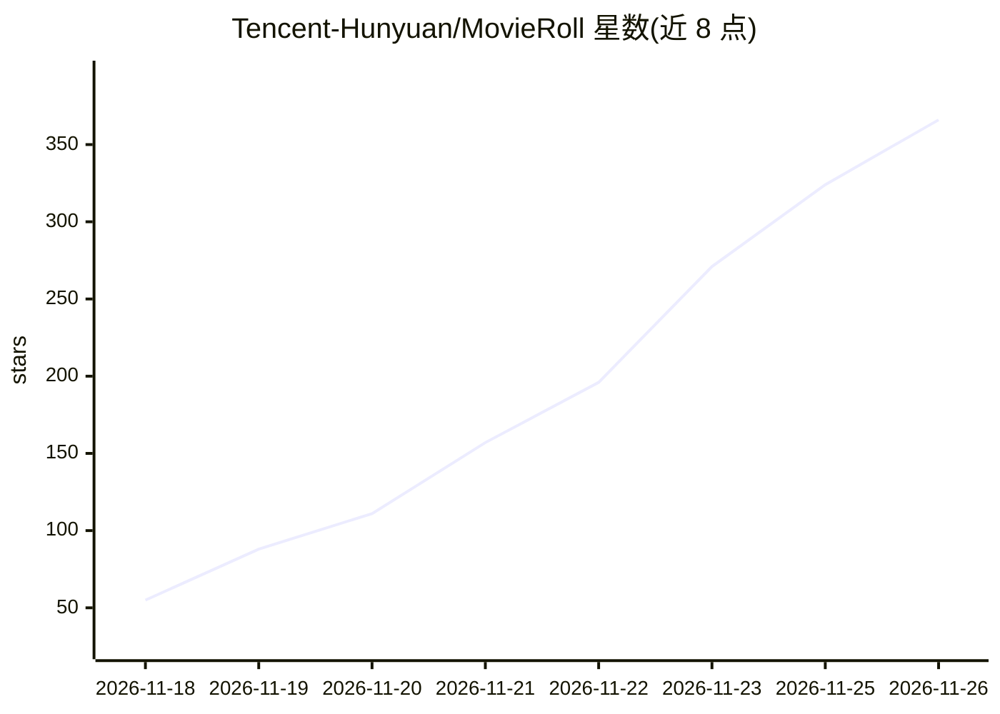

# Tencent-Hunyuan/MovieRoll

⭐ 366 · Python · NOASSERTION · 推送 2026-11-17 · [GitHub](https://github.com/Tencent-Hunyuan/MovieRoll) · 组织维护 · 中文 README

**长视频生成模型框架：从文本/图像提示持续生成480p长视频**

腾讯混元与北京大学等合作的视频生成模型框架，训练与推理一体化：先用窗口级教师强制训练 MovieRoll-Base，再经 ODE 初始化与 CuLT-DMD 蒸馏得到 5 步去噪的 MovieRoll-Distilled（T2V/I2V，480p，任意宽高比）。推理采用联合窗口去噪、分层 KV 缓存与缓存重算支持连续生成，支持单事件与多事件提示序列。权重托管于 HuggingFace（需认证下载门控权重），提供原生推理入口及 SGLang Diffusion、vLLM-Omni 后端指南。限制：原生入口尚不支持 CPU offload，单卡需约 96 GB 显存，消费级 GPU 支持在 TODO 中。

## 筛选速览

| 维度 | 判定 | 备注 |
|---|---|---|
| AI 角色 | `ai-native` | 本体是模型或模型工具 |
| 许可风险 | `none` | NOASSERTION |
| 部署形态 | `library` | 以包/库形式分发 |
| 模型依赖 | local-ok | 支持本地模型 |
| 硬件要求 | — | 无带数字的原话,不猜 |
| 安装摩擦 | `medium` | 含编译或系统依赖之一 |
| 成熟度 | — | 结构信号不足 |

## 能力要点

- Base（50 步 AnnealCFG）与 Distilled（5 步无 CFG）两类 480p 检查点
- 分层 KV 缓存、联合窗口去噪与缓存重算支撑长时连续生成
- 支持单事件与多事件提示的文生视频和图生视频
- 提供面向 coding agent 的 SKILL.md 技能文件夹（提示改写、运行、移植、部署）

## 适用场景

- 用长而详细的提示生成连续长视频
- 按事件序列在单个视频中依次呈现多个情节
- 研究长视频生成的训练与蒸馏方法（四阶段训练流程）

## 场景标签

`视频生成` · 领域:内容生成

## 证据(README 行号)

> L41: MovieRoll is a systematic framework for rolling out long-form videos, from a supervised Base model to a few-step Di
> L53: |MovieRoll-Base|T2V (text-to-video), I2V (image-to-video)|480p (arbitrary aspect ratios)|50|AnnealCFG|base|

## 星数曲线

2026-11-18 55 → 2026-11-26 366（+311）

---
*卡片 v1 · prompt 1.4 · 生成 2026-11-18 · 置信度 mid · 依据 README sha `3788955aa11d` · [字段定义](../../DATASET.md)*
