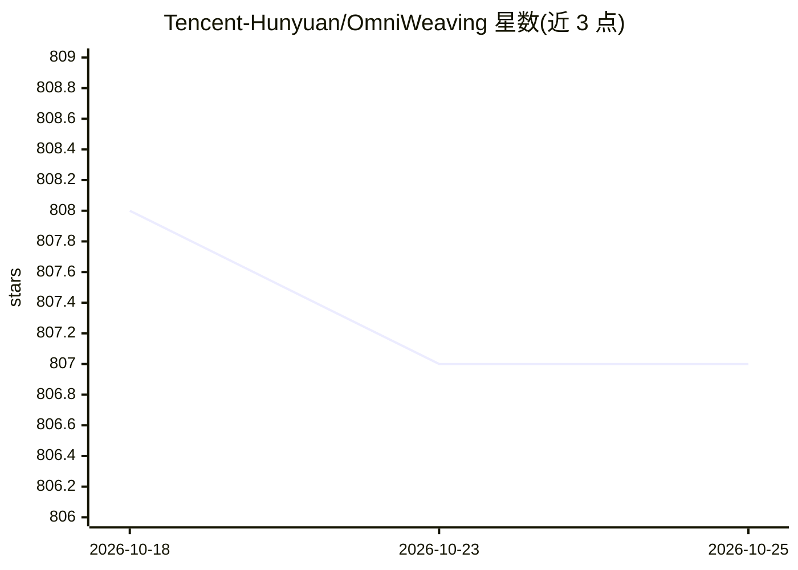

# Tencent-Hunyuan/OmniWeaving

⭐ 807 · Python · NOASSERTION · 推送 2026-04-11 · [GitHub](https://github.com/Tencent-Hunyuan/OmniWeaving) · [官网](https://omniweaving.github.io/) · 组织维护 · 中文 README

**腾讯混元统一视频生成模型：文/图/视频输入生成视频**

由腾讯混元 HunyuanVideo 团队与浙江大学等合作发布的统一视频生成模型，基于 HunyuanVideo-1.5 骨干，采用 MLLM+MMDiT+VAE 架构。支持文生视频、首帧/关键帧生视频、参考图生成、视频编辑、多图组合生成与推理增强生成（--think 激活 MLLM 思考模式先生成增强提示词）等八类任务。另发布评测基准 IntelligentVBench。提供推理代码、模型权重（HuggingFace 下载）、训练数据构造与训练示例代码；依赖 Flash Attention 等库，默认配置 8 GPU 推理，支持 offloading 缓解显存压力。

## 筛选速览

| 维度 | 判定 | 备注 |
|---|---|---|
| AI 角色 | `ai-native` | 本体是模型或模型工具 |
| 许可风险 | `none` | NOASSERTION |
| 部署形态 | `library` | 以包/库形式分发 |
| 模型依赖 | — | README 未给出锁定关系 |
| 硬件要求 | — | 无带数字的原话,不猜 |
| 安装摩擦 | `low` | 无编译、无系统依赖或容器化 |
| 成熟度 | — | 结构信号不足 |

## 能力要点

- 八类统一视频生成任务（t2v/i2v/插值/参考图/编辑/tiv2v 等）
- --think 激活 MLLM 思考模式，先推理用户意图再生成视频
- MLLM+MMDiT+VAE 架构与多层隐状态 DeepStacking 机制
- 开源推理代码、模型权重与训练数据构造代码，并发布 IntelligentVBench 评测基准

## 适用场景

- 用文本或图片组合生成视频内容
- 对现有视频做指令式编辑与风格化
- 以多张参考图做主体组合的视频生成
- 评估统一视频生成模型的智能水平（IntelligentVBench）

## 场景标签

`视频生成` `模型评测` · 领域:评测与运维

## 证据(README 行号)

> L48: We propose OmniWeaving **OmniWeaving**, an omni-level video generation model featuring powerful multimodal composit
> L27: * 📌 OmniWeaving is developed by the **HunyuanVideo** team and is built upon the latest **HunyuanVideo-1.5** as the 

## 星数曲线

2026-10-18 808 → 2026-10-25 807（-1）

---
*卡片 v1 · prompt 1.4 · 生成 2026-10-21 · 置信度 high · 依据 README sha `6ee839ce6a5a` · [字段定义](../../DATASET.md)*
