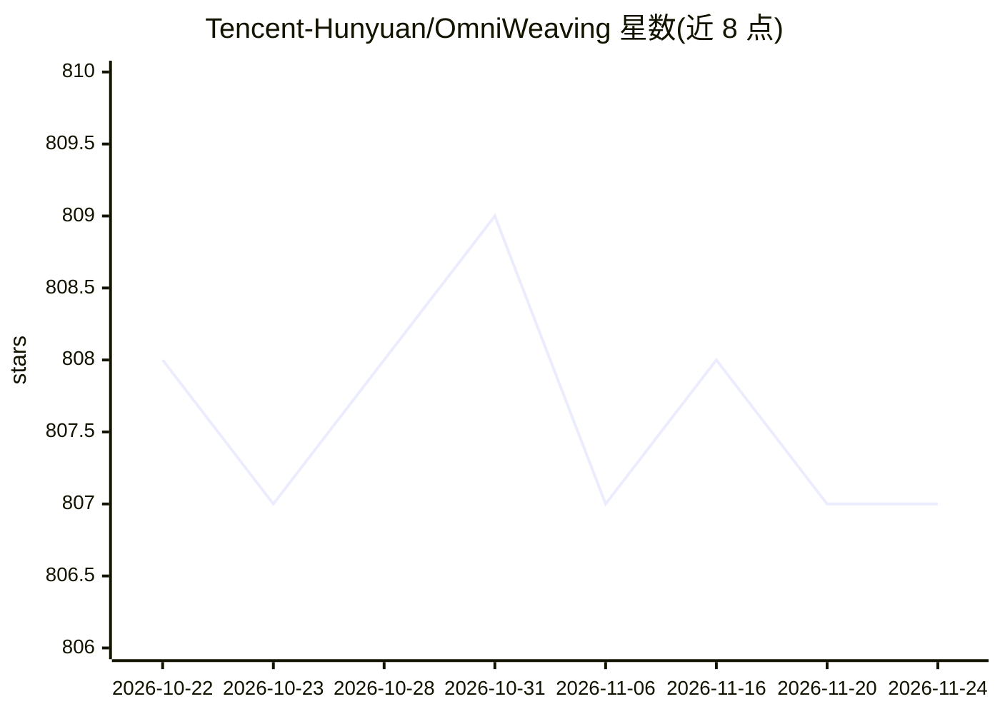

# Tencent-Hunyuan/OmniWeaving

⭐ 807 · Python · NOASSERTION · 推送 2026-10-30 · [GitHub](https://github.com/Tencent-Hunyuan/OmniWeaving) · [官网](https://omniweaving.github.io/) · 组织维护 · 中文 README

**腾讯混元开源的统一视频生成模型：多图/视频自由组合与推理生成**

基于 HunyuanVideo-1.5 骨干的统一视频生成模型，采用 MLLM+MMDiT+VAE 架构，支持文本、多图、视频交错输入的时间绑定与用户意图推理。提供 8 类任务：文生视频、首帧/关键帧生视频、指令视频编辑、参考主体组合生成及推理增强生成（--think 激活 MLLM 思考模式）。已开源推理代码、模型权重（HuggingFace）、训练数据构建与训练示例代码，另发布 IntelligentVBench 基准。默认推理配置使用 8 卡 GPU，提供 CPU offloading 等省显存选项。

## 筛选速览

| 维度 | 判定 | 备注 |
|---|---|---|
| AI 角色 | `ai-native` | 本体是模型或模型工具 |
| 许可风险 | `none` | NOASSERTION |
| 部署形态 | `library` | 以包/库形式分发 |
| 模型依赖 | — | README 未给出锁定关系 |
| 硬件要求 | — | 无带数字的原话,不猜 |
| 安装摩擦 | `low` | 无编译、无系统依赖或容器化 |
| 成熟度 | — | 结构信号不足 |

## 能力要点

- 8 类统一视频生成任务（T2V/I2V/插帧/编辑/参考组合等）
- --think 推理模式：MLLM 先推理用户意图再生成视频
- MLLM 中间层 hidden states DeepStacking 注入多粒度语义条件
- 推理代码、权重、训练数据构建与训练代码均已开源

## 适用场景

- 多参考图组合生成多主体视频
- 按文字指令对已有视频做编辑与风格化
- 需要先理解模糊意图再生成的视频创作

## 场景标签

`视频生成` `多模态` · 领域:内容生成

## 证据(README 行号)

> L49: We propose OmniWeaving **OmniWeaving**, an omni-level video generation model featuring powerful multimodal composit
> L76:  Text-to-Video (T2V)
> L111:  Reasoning-Augmented Video Generation

## 星数曲线

2026-10-22 808 → 2026-11-24 807（-1）

---
*卡片 v1 · prompt 1.4 · 生成 2026-11-24 · 置信度 high · 依据 README sha `d2394be8e84b` · [字段定义](../../DATASET.md)*
