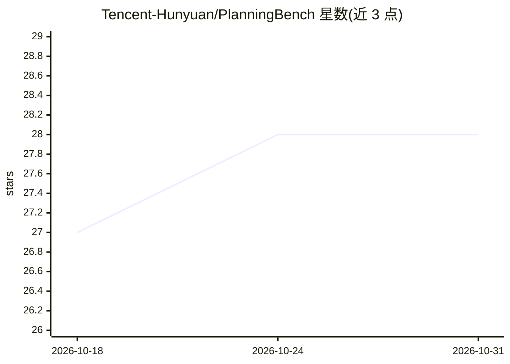

# Tencent-Hunyuan/PlanningBench

⭐ 28 · NOASSERTION · 推送 2026-05-29 · [GitHub](https://github.com/Tencent-Hunyuan/PlanningBench) · 组织维护 · 中文 README

**面向 LLM 的合成规划基准与数据构建框架（467 评测实例）**

腾讯混元与中国人民大学发布的合成规划基准：将现实规划场景抽象为任务分类法、约束族与难度因子，覆盖排程、生产运营、路径、应急响应、资源分配、排班六大类，超过 30 种具体任务类型。每条实例含规划问题与验证清单，用于评测模型在耦合约束下生成完整可执行计划的成功能力。构建管线为约束驱动合成，由 Generator 生成、Responder 求解、Critic 校验，再经自动过滤与人工质检。当前发布 467 条人工编写与校验的评测实例，定位为基准/测试数据而非训练数据。

## 筛选速览

| 维度 | 判定 | 备注 |
|---|---|---|
| AI 角色 | `ai-knowledge` | 知识聚合/清单类 |
| 许可风险 | `none` | NOASSERTION |
| 部署形态 | `None` |  |
| 模型依赖 | — | README 未给出锁定关系 |
| 硬件要求 | — | 无带数字的原话,不猜 |
| 安装摩擦 | `low` | 无编译、无系统依赖或容器化 |
| 成熟度 | — | 结构信号不足 |

## 能力要点

- 467 条合成规划评测实例，每条附验证清单
- 六大规划任务族、30+ 具体任务类型的分类体系
- Generator–Responder–Critic 约束驱动合成管线，难度可调
- 数据经人工编写、校验与质检，不含业务数据

## 适用场景

- 评测 LLM 在耦合约束下的完整规划生成能力
- 研究约束紧度、资源稀缺度等因素对任务难度的影响
- 作为规划任务的测试基准（官方声明不作用作训练数据）

## 场景标签

`模型评测` · 领域:评测与运维

## 证据(README 行号)

> L10: PlanningBench is a synthetic planning benchmark and data construction framework for evaluating and training large l
> L20: The current repository releases **467 synthetic planning instances**, and all 467 instances are intended for **eval

## 星数曲线

2026-10-18 27 → 2026-10-31 28（+1）

---
*卡片 v1 · prompt 1.4 · 生成 2026-10-26 · 置信度 high · 依据 README sha `c2851365e8f7` · [字段定义](../../DATASET.md)*
