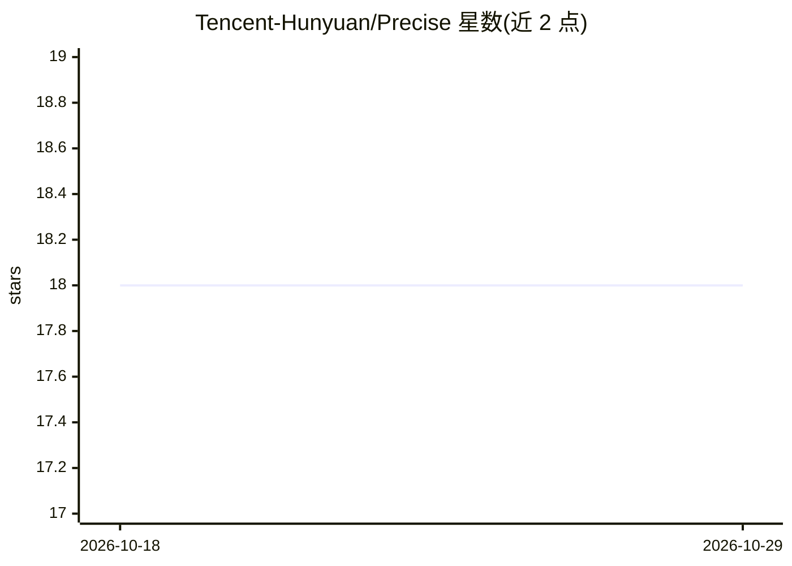

# Tencent-Hunyuan/Precise

⭐ 18 · Python · NOASSERTION · 推送 2026-10-22 · [GitHub](https://github.com/Tencent-Hunyuan/Precise) · [官网](https://totalhuang.github.io/Precise-SDE-Project-Page/) · 组织维护 · 中文 README

**流匹配模型 RL 后训练的 SDE 一致随机采样器（NeurIPS 2026）**

腾讯混元与北京大学团队的研讨论文官方实现：提出 Precise 采样器，通过 logSNR 推导的探索调度与闭式有限步转移，将流匹配模型的确定性采样轨迹转为随机策略，用于在线 RL 后训练（GRPO 类算法）。仓库提供 FLUX.2 Klein 训练入口、评测脚本与 GenEval/UnifiedReward 奖励服务器集成，支持 precise/flow_grpo/cps/dance_grpo 等采样模式；SD3 脚本尚未发布。基于 Flow-GRPO 代码库构建，需 CUDA Linux 环境，模型权重经 Hugging Face 固定 checkpoint 解析。

## 筛选速览

| 维度 | 判定 | 备注 |
|---|---|---|
| AI 角色 | `ai-native` | 本体是模型或模型工具 |
| 许可风险 | `none` | NOASSERTION |
| 部署形态 | `library` | 以包/库形式分发 |
| 模型依赖 | — | README 未给出锁定关系 |
| 硬件要求 | — | 无带数字的原话,不猜 |
| 安装摩擦 | `medium` | 含编译或系统依赖之一 |
| 成熟度 | — | 结构信号不足 |

## 能力要点

- logSNR 推导探索调度与冻结 clean-latent 后验均值的闭式转移近似
- 支持多种 SDE 模式对比（precise/flow_grpo/cps/dance_grpo）
- FLUX.2 Klein 训练入口与 launcher 脚本
- GenEval 与 UnifiedReward v2 隔离奖励服务器集成

## 适用场景

- 对 FLUX.2 Klein 等流匹配模型做 RL 后训练以提升对齐分数
- 复现论文中与 Dance-GRPO/Flow-GRPO/CPS 的对比实验
- 用 PickScore/HPSv2 等奖励指标评测训练后 checkpoint

## 场景标签

`强化学习` · 领域:训练与推理

## 证据(README 行号)

> L34: We decompose stochastic sampler design into two coupled problems: choosing an exploration schedule that balances di
> L36: Across FLUX.2 Klein experiments, Precise improves reward optimization speed and stability, reaches state-of-the-art
> L26: - Code for Precise-SDE is available in this repository, including the Precise sampler, FLUX.2 Klein training entryp

## 星数曲线

2026-10-18 18 → 2026-10-29 18（+0）

---
*卡片 v1 · prompt 1.4 · 生成 2026-10-29 · 置信度 mid · 依据 README sha `150cf1cae0d1` · [字段定义](../../DATASET.md)*
