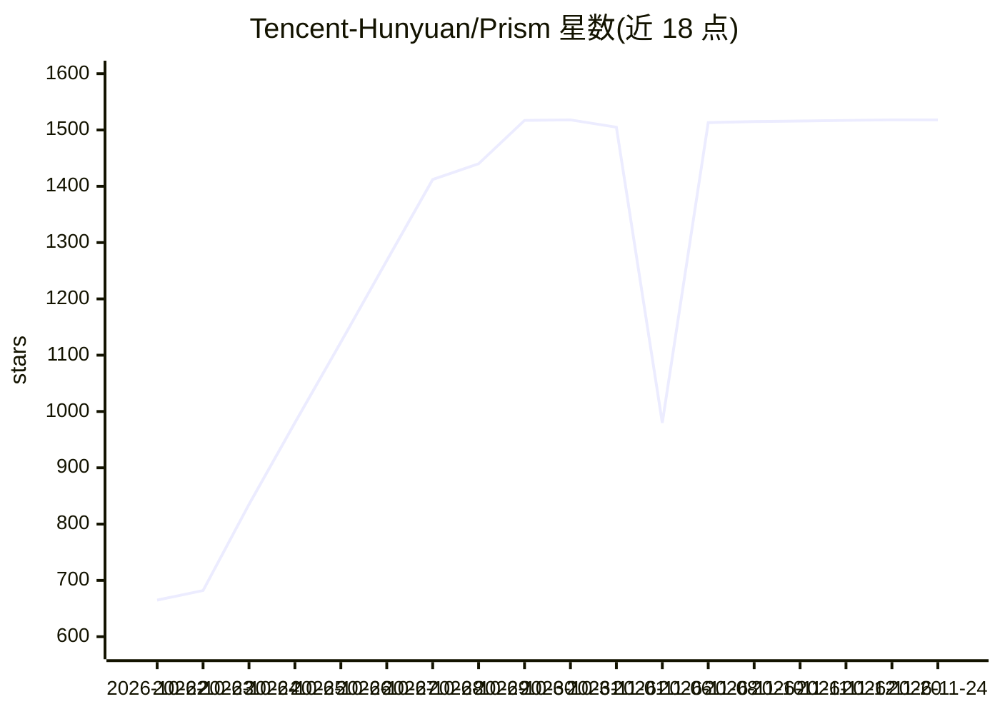

# Tencent-Hunyuan/Prism

⭐ 1,519 · Python · NOASSERTION · 推送 2026-10-31 · [GitHub](https://github.com/Tencent-Hunyuan/Prism) · [官网](https://francis-rings.github.io/Prism) · 组织维护 · 中文 README

**2K 视频-音频联合生成的动态稀疏注意力训练框架**

来自腾讯混元、复旦大学与浙江大学的研究项目：将 token 序列组织为时空宏区，依据视频特征方差与音频-视频交叉注意力信号动态分配块形状，配合混合块选择策略实现逐查询稀疏化。官方声称相比全注意力训练加速 2.5 倍。提供预览模型检查点、数据预处理（WAN VAE 潜变量提取与分桶 CSV 构建）、训练与推理代码，支持 720p/1080p/2K 分辨率的原生联合视频-音频生成与训练，推理可用 DeepSpeed 或 FSDP 多 GPU 方式运行。

## 筛选速览

| 维度 | 判定 | 备注 |
|---|---|---|
| AI 角色 | `ai-native` | 本体是模型或模型工具 |
| 许可风险 | `none` | NOASSERTION |
| 部署形态 | `library` | 以包/库形式分发 |
| 模型依赖 | — | README 未给出锁定关系 |
| 硬件要求 | — | 无带数字的原话,不猜 |
| 安装摩擦 | `medium` | 含编译或系统依赖之一 |
| 成熟度 | `idea` | |

## 能力要点

- 动态稀疏注意力：时空宏区分块与逐查询稀疏度选择
- 支持 720p/1080p/2K 原生联合视频-音频训练与推理
- 提供潜变量提取、多分辨率分桶 CSV 构建的完整数据预处理流程
- 单 GPU 80GB 或 4+ GPU（FSDP/DeepSpeed）推理方案

## 适用场景

- 以文本与音频提示生成带声音的视频
- 在 2K 分辨率下微调视频-音频联合生成模型
- 基于参考图做图生视频并配音频

## 场景标签

`视频生成` `微调` `多模态` · 领域:内容生成

## 证据(README 行号)

> L32: To address this, we propose Prism, a dynamic sparse attention framework for natively training joint video-audio gen
> L54: The Preview Model supports native joint video-audio generation at 720p, 1080p, and 2K resolutions, as well as nativ
> L199: Prism supports native joint video-audio training at 720p, 1080p, and 2K resolutions. The training pipeline uses FS

## 星数曲线

2026-10-22 665 → 2026-11-24 1,518（+853）

---
*卡片 v1 · prompt 1.4 · 生成 2026-11-23 · 置信度 high · 依据 README sha `f3249f84dae0` · [字段定义](../../DATASET.md)*
