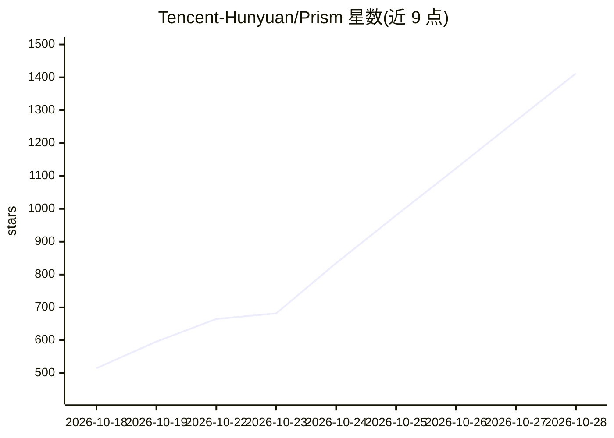

# Tencent-Hunyuan/Prism

⭐ 1,440 · Python · NOASSERTION · 推送 2026-10-15 · [GitHub](https://github.com/Tencent-Hunyuan/Prism) · [官网](https://francis-rings.github.io/Prism) · 组织维护 · 中文 README

**面向研究者的动态稀疏注意力联合视频-音频生成训练框架**

腾讯混元与复旦、浙大联合发布的动态稀疏注意力框架，用于原生训练 2K 分辨率的联合视频-音频生成模型。将 token 序列组织为时空宏区，依据视频特征方差与音频-视频交叉注意力范数为每个区动态分配块形状，并以混合块选择策略确定稀疏度。提供 720p/1080p/2K 的推理与训练代码、数据预处理流水线（WAN VAE latent 提取与多分辨率分桶）和预览版权重，训练需 FSDP + 序列并行，运行依赖 CUDA ≥ 12.4 与系统级 ffmpeg。

## 筛选速览

| 维度 | 判定 | 备注 |
|---|---|---|
| AI 角色 | `ai-native` | 本体是模型或模型工具 |
| 许可风险 | `none` | NOASSERTION |
| 部署形态 | `library` | 以包/库形式分发 |
| 模型依赖 | — | README 未给出锁定关系 |
| 硬件要求 | — | 无带数字的原话,不猜 |
| 安装摩擦 | `medium` | 含编译或系统依赖之一 |
| 成熟度 | — | 结构信号不足 |

## 能力要点

- 原生 720p/1080p/2K 联合视频-音频生成与训练
- 动态稀疏注意力（块稀疏 + 动态块形状分配）
- 提供训练/微调/推理代码与数据预处理（latent 提取、分桶 CSV）工具
- 支持 DeepSpeed 与 FSDP 多卡推理、CPU offload 与 VAE 空间分块

## 适用场景

- 在自有视频-音频数据上原生训练高分辨率联合生成模型
- 运行预览权重生成 720p–2K 带音频视频
- 研究稀疏注意力在视频-音频联合建模中的应用

## 场景标签

`视频生成` `模型训练` · 领域:内容生成

## 证据(README 行号)

> L30: To address this, we propose Prism, a dynamic sparse attention framework for natively training joint video-audio gen
> L160: Prism provides two inference scripts: `prism_infer.sh` for single-GPU or DeepSpeed-based multi-GPU inference, and 
> L197: Prism supports native joint video-audio training at 720p, 1080p, and 2K resolutions. The training pipeline uses FS

## 星数曲线

2026-10-18 515 → 2026-10-28 1,412（+897）

---
*卡片 v1 · prompt 1.4 · 生成 2026-10-21 · 置信度 mid · 依据 README sha `463747dc27dc` · [字段定义](../../DATASET.md)*
