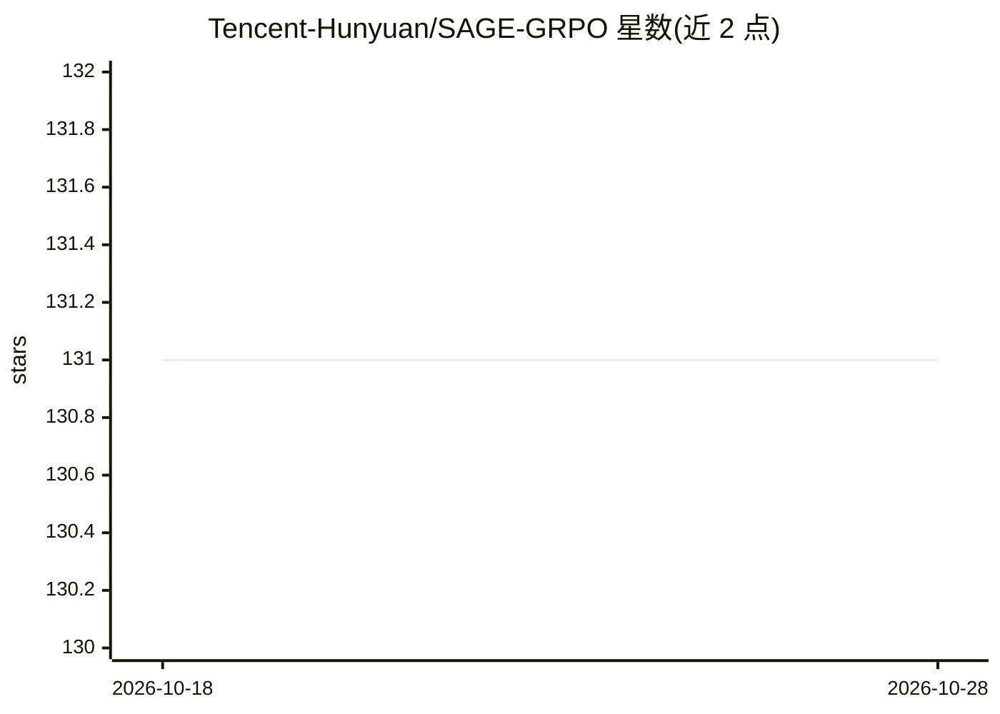

# Tencent-Hunyuan/SAGE-GRPO

⭐ 131 · Python · NOASSERTION · 推送 2026-04-02 · [GitHub](https://github.com/Tencent-Hunyuan/SAGE-GRPO) · [官网](https://dungeonmassster.github.io/SAGE-GRPO-Page/) · 组织维护 · 中文 README

**视频生成模型的 GRPO 后训练对齐框架（基于 HunyuanVideo-1.5）**

腾讯混元与 HKUST 合作的论文官方实现：面向视频生成模型的 GRPO 强化学习后训练框架，构建在 HunyuanVideo-1.5 之上。核心机制包括精确流形感知 SDE 探索、双重信赖域 KL 正则（移动锚点+逐步约束）、梯度范数均衡器，支持序列并行与 FSDP 的多机多 GPU 训练。推荐配置为 8 节点 64 卡、单卡 80GB 显存的 Linux 环境，需预下载基础模型与 VideoReward 奖励模型权重到 ./ckpts 目录。

## 筛选速览

| 维度 | 判定 | 备注 |
|---|---|---|
| AI 角色 | `ai-ecosystem` | LLM/agent 周边工具 |
| 许可风险 | `none` | NOASSERTION |
| 部署形态 | `library` | 以包/库形式分发 |
| 模型依赖 | — | README 未给出锁定关系 |
| 硬件要求 | `gpu-24g` | |
| 安装摩擦 | `low` | 无编译、无系统依赖或容器化 |
| 成熟度 | — | 结构信号不足 |

## 能力要点

- 精确流形感知 SDE 探索（对数曲率修正项）
- 双重信赖域 KL 正则与梯度范数均衡器
- 序列并行 + FSDP 的多机多 GPU 训练
- 支持 sage_grpo / dance_grpo / flow_grpo / cps 四种 SDE 切换

## 适用场景

- 对 HunyuanVideo-1.5 做奖励模型引导的强化学习后训练
- 复现或对比不同视频 GRPO 方法的训练行为
- 大规模集群上开展视频生成模型对齐实验

## 场景标签

`强化学习` `模型训练` · 领域:训练与推理

## 证据(README 行号)

> L27: SAGE-GRPO is an open-source post-training framework for aligning video generation models via GRPO, built on top of 
> L49: We evaluate SAGE-GRPO on HunyuanVideo-1.5 using VideoAlign as the reward model and observe consistent gains over pr

## 星数曲线

2026-10-18 131 → 2026-10-28 131（+0）

---
*卡片 v1 · prompt 1.4 · 生成 2026-10-22 · 置信度 mid · 依据 README sha `d9b617c16ec3` · [字段定义](../../DATASET.md)*
