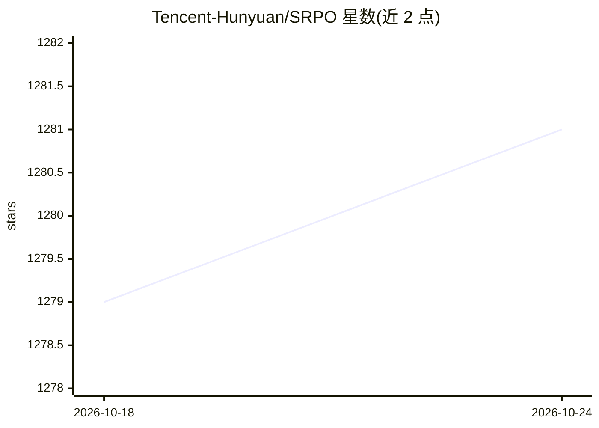

# Tencent-Hunyuan/SRPO

⭐ 1,281 · Python · NOASSERTION · 推送 2026-05-11 · [GitHub](https://github.com/Tencent-Hunyuan/SRPO) · [官网](https://tencent.github.io/srpo-project-page/) · 组织维护 · 中文 README

**按细粒度人类偏好对齐扩散模型全轨迹的训练方法与代码**

腾讯混元与高校合作的文本到图像扩散模型强化学习对齐方法（SRPO）：通过新的采样策略直接在扩散去噪轨迹上用解析梯度优化，支持在线 rollout 或少于 1500 张真实图像的离线替代方案，配合 HPS-v2.1/PickScore 等奖励模型微调 FLUX.1-dev 与 Qwen-Image，并用负奖励正则化缓解 reward hacking。提供训练与推理代码、ComfyUI 工作流和 Hugging Face 权重下载，依赖环境与 DanceGRPO 基本一致。面向扩散模型研究者与微调实践者。

## 筛选速览

| 维度 | 判定 | 备注 |
|---|---|---|
| AI 角色 | `ai-ecosystem` | LLM/agent 周边工具 |
| 许可风险 | `none` | NOASSERTION |
| 部署形态 | `None` |  |
| 模型依赖 | — | README 未给出锁定关系 |
| 硬件要求 | — | 无带数字的原话,不猜 |
| 安装摩擦 | `low` | 无编译、无系统依赖或容器化 |
| 成熟度 | — | 结构信号不足 |

## 能力要点

- 直接对齐扩散全轨迹，单图 rollout + 解析梯度，FLUX.1-dev 训练 10 分钟内见效
- 支持在线训练与离线真实图像数据（少于 1500 张即可）两种模式
- 负奖励正则化缓解过拟合颜色/过饱和等 reward hacking
- 支持 FLUX.1-dev 与 Qwen-Image，提供 ComfyUI 工作流

## 适用场景

- 用人类偏好奖励模型微调文生图扩散模型
- 研究扩散轨迹级 RL 对齐方法并复现论文结果
- 通过 ComfyUI 使用已发布的 SRPO 权重做推理

## 场景标签

`微调` `强化学习` `图像生成` · 领域:内容生成

## 证据(README 行号)

> L1: Directly Aligning the Full Diffusion Trajectory with Fine-Grained Human Preference
> L31: 1. **Direct Align**: We introduce a new sampling strategy for diffusion fine-tuning that can effectively restore hi
> L47: - [x] Training code (FLUX.1-dev)
> L48: - [x] Support Qwen-Image

## 星数曲线

2026-10-18 1,279 → 2026-10-24 1,281（+2）

---
*卡片 v1 · prompt 1.4 · 生成 2026-10-21 · 置信度 high · 依据 README sha `37e11053d1f1` · [字段定义](../../DATASET.md)*
