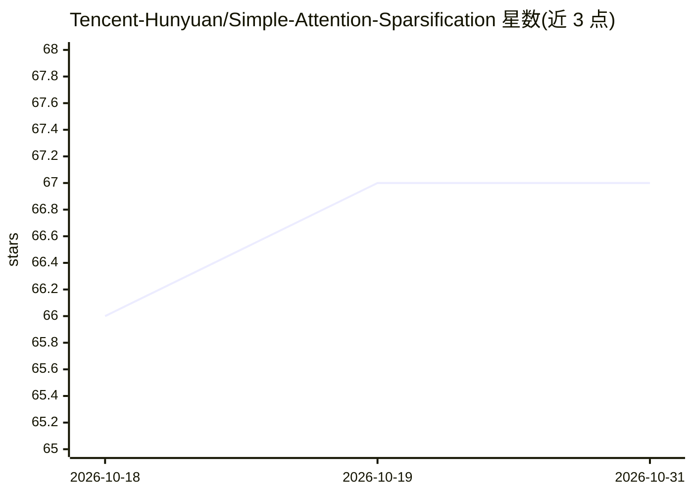

# Tencent-Hunyuan/Simple-Attention-Sparsification

⭐ 67 · Python · 推送 2026-09-14 · [GitHub](https://github.com/Tencent-Hunyuan/Simple-Attention-Sparsification) · 组织维护 · 中文 README

**论文代码：可端到端优化上下文排序的门控稀疏注意力方法 SAS**

腾讯混元团队的 NeurIPS 2026 论文官方代码。SAS 在保留离散 Top-K 稀疏计算的同时为每个选中块引入连续软门控，把门控纳入注意力 logits，建立从语言建模损失到选择器的可微路径，从而端到端优化上下文排序，无需蒸馏原始稠密注意力。提供 Qwen3-4B/8B/14B 训练配方与 SGLang 稀疏注意力后端，训练需 8 张 NVIDIA H20 GPU，评测覆盖 MATH/GPQA/AIME、LongBench-E、BFCL/VitaBench，通过 pixi 环境与 git 子模块安装。

## 筛选速览

| 维度 | 判定 | 备注 |
|---|---|---|
| AI 角色 | `ai-ecosystem` | LLM/agent 周边工具 |
| 许可风险 | `none` | — |
| 部署形态 | `None` |  |
| 模型依赖 | — | README 未给出锁定关系 |
| 硬件要求 | — | 无带数字的原话,不猜 |
| 安装摩擦 | `low` | 无编译、无系统依赖或容器化 |
| 成熟度 | — | 结构信号不足 |

## 能力要点

- 连续软门控建立语言建模损失到选择器的可微路径
- Qwen3-4B/8B/14B 训练配方（OpenR1-Math-220k 数据集）
- 基于 SGLang fork 的 block-sparse 评测后端
- 推理/长上下文/Agentic 三类基准评测脚本

## 适用场景

- 复现论文中稀疏注意力训练与评测流程
- 在 Qwen3 模型上训练上下文排序门控
- 在稀疏注意力设定下跑 MATH/LongBench/BFCL 等基准

## 场景标签

`模型训练` · 领域:训练与推理

## 证据(README 行号)

> L7: **SAS** is a gated sparse-attention mechanism that learns, per query, which blocks to attend to — optimizing the con
> L38: SAS currently provides training recipes for the
> L55: > can be trained on 8 NVIDIA H20 GPUs. We open-source the complete training and

## 星数曲线

2026-10-18 66 → 2026-10-31 67（+1）

---
*卡片 v1 · prompt 1.4 · 生成 2026-10-24 · 置信度 high · 依据 README sha `430ae3412007` · [字段定义](../../DATASET.md)*
