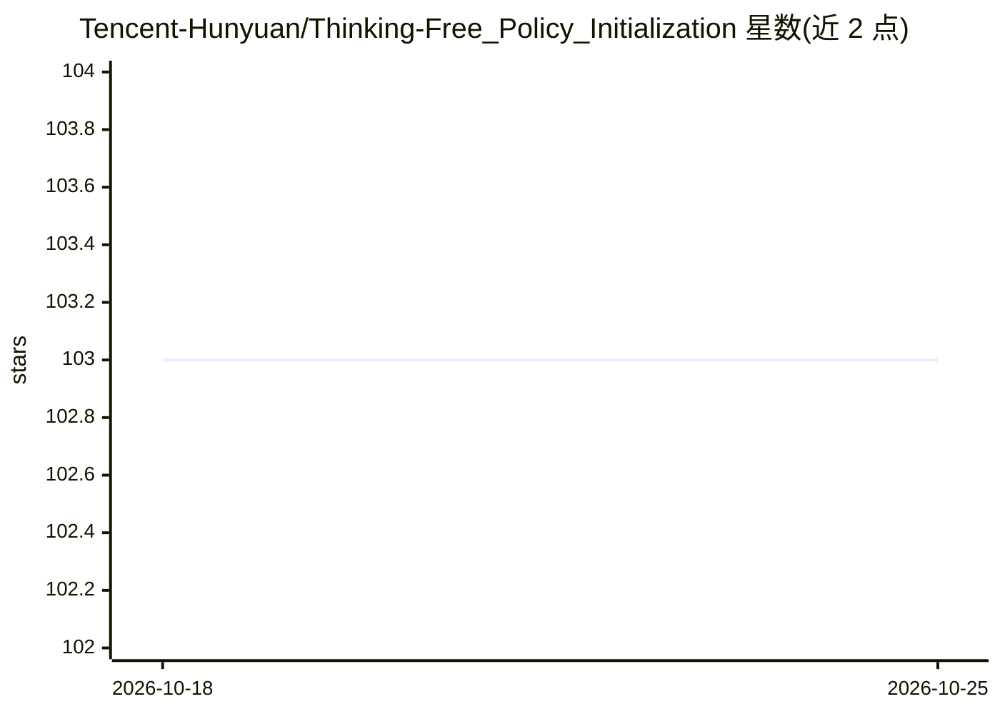

# Tencent-Hunyuan/Thinking-Free_Policy_Initialization

⭐ 103 · Python · NOASSERTION · 推送 2026-01-27 · [GitHub](https://github.com/Tencent-Hunyuan/Thinking-Free_Policy_Initialization) · 组织维护 · 中文 README

**面向研究者的 RLVR 训练方法代码：跳过思考阶段的策略初始化**

ICLR 2026 论文 TFPI 的官方代码，来自腾讯混元与港科大、港大团队。TFPI 是对可验证奖励强化学习（RLVR）的改造：通过直接追加 </think> 显式丢弃思考内容，衔接长 CoT 蒸馏与标准 RLVR，以降低推理 token 消耗并加速 RL 收敛。仓库提供基于 Polaris-53K 训练集与 vLLM 的训练、评测脚本，并在 Hugging Face 开源 1.5B/4B 多阶段模型检查点（Qwen3-4B 在 AIME24 达 89.0%）。安装依赖 conda、PyTorch cu124、vLLM、flash-attn 等。

## 筛选速览

| 维度 | 判定 | 备注 |
|---|---|---|
| AI 角色 | `ai-ecosystem` | LLM/agent 周边工具 |
| 许可风险 | `none` | NOASSERTION |
| 部署形态 | `library` | 以包/库形式分发 |
| 模型依赖 | local-ok | 支持本地模型 |
| 硬件要求 | — | 无带数字的原话,不猜 |
| 安装摩擦 | `medium` | 含编译或系统依赖之一 |
| 成熟度 | — | 结构信号不足 |

## 能力要点

- ThinkingFree 操作：直接追加 </think> 丢弃思考内容
- 训练与评测脚本（Polaris-53K 训练集、TFPI-EVA 评测集）
- 开源 1.5B 与 4B 多阶段模型检查点
- Qwen3-4B 在 AIME24 达 89.0%、LiveCodeBench 65.5%

## 适用场景

- 复现 TFPI 论文的训练与评测流程
- 基于开源检查点做低算力推理模型训练研究
- 研究 RLVR 中的 token 效率优化方法

## 场景标签

`强化学习` `模型训练` · 领域:训练与推理

## 证据(README 行号)

> L24: **T**hinking-**F**ree **P**olicy **I**nitialization (**TFPI**), a simple yet effective adaptation to Reinforcement 
> L46: pip install -e .

## 星数曲线

2026-10-18 103 → 2026-10-25 103（+0）

---
*卡片 v1 · prompt 1.4 · 生成 2026-10-23 · 置信度 high · 依据 README sha `1f7fc221f6ce` · [字段定义](../../DATASET.md)*
