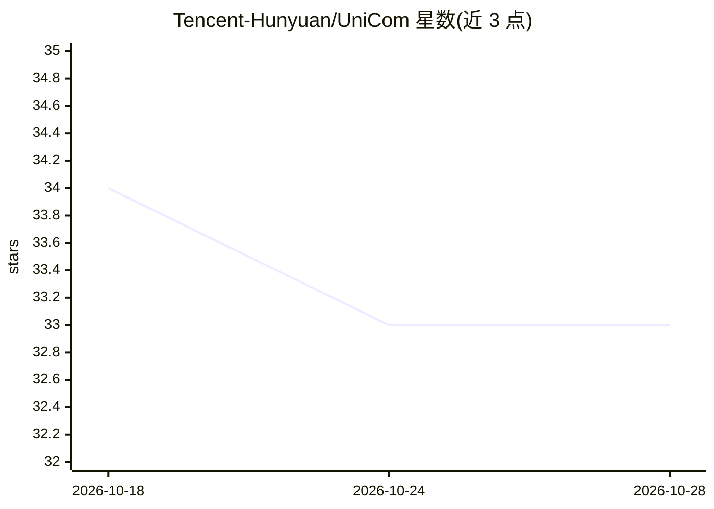

# Tencent-Hunyuan/UniCom

⭐ 33 · Python · NOASSERTION · 推送 2026-04-13 · [GitHub](https://github.com/Tencent-Hunyuan/UniCom) · 组织维护 · 中文 README

**统一多模态模型：在压缩视觉嵌入上做文生图与图像编辑**

腾讯混元开源的论文官方代码，UniCom 是在压缩连续视觉嵌入上直接生成的大规模多模态模型，作为理解与生成的统一接口；本仓库提供文生图、单图/多图编辑、图像重建的推理管线。机制上沿通道维度压缩视觉特征以保留语义与细节，管线先导出潜在表示再解码为图像，依赖 SigLIP2 编码、Decoder Transformer 与 Flux VAE 组件。通过 HuggingFace CLI 下载模型权重，conda 环境加 PyTorch（按 CUDA 版本）与 requirements.txt 安装，命令行脚本运行。

## 筛选速览

| 维度 | 判定 | 备注 |
|---|---|---|
| AI 角色 | `ai-native` | 本体是模型或模型工具 |
| 许可风险 | `none` | NOASSERTION |
| 部署形态 | `library` | 以包/库形式分发 |
| 模型依赖 | — | README 未给出锁定关系 |
| 硬件要求 | — | 无带数字的原话,不猜 |
| 安装摩擦 | `medium` | 含编译或系统依赖之一 |
| 成熟度 | — | 结构信号不足 |

## 能力要点

- 在压缩连续视觉嵌入上直接生成，统一理解与生成接口
- 支持文生图、单图/多图编辑、图像重建与 CSV 批量推理
- 沿通道维度压缩视觉特征以保留语义与细粒度细节
- 管线先导出 latents 再解码为图像

## 适用场景

- 研究者复现论文的文生图与图像编辑结果
- 基于命令行做文本到图像生成与批量推理
- 多图组合编辑（把不同图中物体合成到目标场景）

## 场景标签

`图像生成` `多模态` · 领域:内容生成

## 证据(README 行号)

> L10: UniCom is a unified large-scale multimodal model that performs generation directly over compressed visual embedding
> L18: - `Model`: We propose **UniCom**, a unified large-scale multimodal model that performs generation directly over com

## 星数曲线

2026-10-18 34 → 2026-10-28 33（-1）

---
*卡片 v1 · prompt 1.4 · 生成 2026-10-25 · 置信度 high · 依据 README sha `ad5659e02afc` · [字段定义](../../DATASET.md)*
